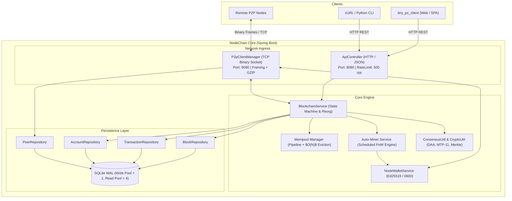

([перейти в Рус. версию](README.md))

# 🦊 NodeChain

<p align="center">
  
  
  
  
  
  
  
</p>

> **Full-featured distributed blockchain node built on Java 17 and Spring Boot.**
> Pure JDK cryptography (`Ed25519`, `SHA-256`, `RFC 6962 Merkle Tree`), embedded SQLite in WAL mode, custom binary P2P protocol with GZIP compression, strict REST API with Token Bucket rate limiting, and an autonomous `tiny_pc_client` web client (Mithril.js + Web Crypto API).

---

## 📑 Table of Contents

- [Architecture](#-architecture)
- [Cryptography & Addressing](#-cryptography--addressing)
- [Consensus & Network Rules](#-consensus--network-rules)
- [Binary P2P Protocol](#-binary-p2p-protocol)
- [Data Layer: SQLite WAL](#-data-layer-sqlite-wal)
- [REST API v1](#-rest-api-v1)
- [Web Client (tiny_pc_client)](#-web-client-tiny_pc_client)
- [Configuration](#-configuration)
- [Quick Start](#-quick-start)
- [Python Client Example](#-python-client-example)
- [Security & Hardening](#-security--hardening)
- [Project Structure](#-project-structure)

---

## 🏛 Architecture

The system follows a layered **Static-First & Clean Layers** design:



---

## 🔐 Cryptography & Addressing

### 1. Keys and Signatures (Ed25519)
* **Algorithm**: `Ed25519` (RFC 8032) using native `java.security` provider in Java 17+.
* **Public Key**: DER X.509 SPKI (44 bytes), Base64 (60 chars).
* **Private Key**: DER PKCS#8 (48 bytes), Base64 (64 chars). Stored in `nodewallet.dat` with `0600` (`rw-------`) permissions.
* **Signature**: Raw binary (64 bytes), Base64 (88 chars).

### 2. Fox Address Format & CRC32 Checksum
Wallet addresses are **64 hex characters** containing brand characters `'f'`, `'o'`, and `'x'` in the first 5 characters with an IEEE 802.3 CRC32 checksum:
1. `hash = SHA256(PublicKey.getEncoded())`.
2. First 3 bytes determine the positions for `'f'`, `'o'`, and `'x'` within index range `0..4`.
3. Characters `0..55` form the address payload.
4. Characters `56..63` (last 8 hex chars) store the `CRC32` checksum of the payload. Validated via `CryptoUtil.isValidAddress()`.

> **Address Example:** `6foxabbe6c0d624d0bb3de4c8375643f4fce0c9744c0096f14b919dfe3f031f1`

### 3. Canonical Signing Format
To prevent Transaction Malleability and Cross-Chain Replay, signatures are created strictly over a canonical string delimited by `|`:
* Without comment:  
  `chainId|from|to|amount|fee|nonce|timestamp`
* With comment:  
  `chainId|from|to|amount|fee|nonce|timestamp|comment.trim()`

**Transaction Hash (SHA-256):**  
`SHA256(chainId|from|to|amount|fee|nonce|timestamp|comment.trim()|signature)`

---

## ⛏ Consensus & Network Rules

* **Account-Based Model**: `address`, `balance` ($10^8$ atomic units = 1 coin), `nonce`.
* **Mempool Pipelining**: Senders can submit consecutive transactions with increasing nonces; spending unconfirmed balance is prohibited (`409 Conflict`).
* **Minimum Relay Fee (`MIN_RELAY_FEE`)**: `1L` atomic unit to prevent spam.
* **Proof-of-Work**: Block hash `SHA256(height|chainId|previousHash|merkleRoot|minerAddress|timestamp|difficulty|nonce)` must begin with `difficulty` hex zeros.
* **Difficulty Adjustment Algorithm (DAA)**: Retargeted every `blockchain.difficulty-adjustment-interval` blocks (default 10) against `target-block-time-seconds = 10`.
* **MTP-11 & Block Timestamps**: Next block timestamp must be $> \text{MTP-11}$ of past blocks and $\le \text{now} + 30\text{s}$. DAA difficulty retargeting rapidly adjusts upwards when block mining accelerates.
* **Network Checkpoints**: `blockchain.checkpoints=<height>:<hash>,...` enforces strict verification of historical block hashes.
* **RFC 6962 Merkle Tree**: Domain separation — leaves are prefixed with `00`, internal nodes with `01`.
* **Halving Algorithm**: Every `blockchain.halving-interval` blocks (210,000), block subsidy halves: `Subsidy = miningReward >> (height / halvingInterval)`. At $\ge 64$ halvings, subsidy becomes 0.
* **Chain Reorganization**: Follows highest cumulative ChainWork ($\sum 16^{\text{difficulty}}$). Maximum reorg depth is capped at `MAX_REORG_DEPTH = 3` blocks.

---

## 📡 Binary P2P Protocol

Nodes communicate using custom binary framing over direct TCP sockets:

```text
 0                   1                   2                   3
 0 1 2 3 4 5 6 7 8 9 0 1 2 3 4 5 6 7 8 9 0 1 2 3 4 5 6 7 8 9 0 1
+-+-+-+-+-+-+-+-+-+-+-+-+-+-+-+-+-+-+-+-+-+-+-+-+-+-+-+-+-+-+-+-+
|          MAGIC (0x4658 "FX")          | FLAG  |               |
+-+-+-+-+-+-+-+-+-+-+-+-+-+-+-+-+-+-+-+-+-+-+-+-+-+-+-+-+-+-+-+-+
|                        REQUEST_ID                             |
+-+-+-+-+-+-+-+-+-+-+-+-+-+-+-+-+-+-+-+-+-+-+-+-+-+-+-+-+-+-+-+-+
|  OP_CODE  |                   PAYLOAD LENGTH                  |
+-+-+-+-+-+-+-+-+-+-+-+-+-+-+-+-+-+-+-+-+-+-+-+-+-+-+-+-+-+-+-+-+
|                      PAYLOAD BYTES (JSON / GZIP)              |
+-+-+-+-+-+-+-+-+-+-+-+-+-+-+-+-+-+-+-+-+-+-+-+-+-+-+-+-+-+-+-+-+
```

| Field | Bytes | Description |
| :--- | :---: | :--- |
| **`MAGIC`** | 2 | Header identifier `0x4658` (ASCII `"FX"`). |
| **`FLAG`** | 1 | `0x00` = Raw JSON, `0x01` = GZIP compressed (auto-compressed if $>128$ bytes). |
| **`REQUEST_ID`** | 4 | Request-response correlation ID. |
| **`OP_CODE`** | 1 | Network protocol command opcode. |
| **`LENGTH`** | 4 | Payload body length (max: 16 B for PING/PONG, 64 KiB for control, 4 MiB for blocks). |

### Operation Codes (OpCodes)

| OpCode | Hex | Name | Purpose |
| :---: | :---: | :--- | :--- |
| **1** | `0x01` | `HANDSHAKE` | Signed initiation (INIT) with ephemeral clientNonce. |
| **2** | `0x02` | `HANDSHAKE_ACK` | Mutual challenge-response (ACK / AUTH) with targetNodeId binding. |
| **3** | `0x03` | `PING` | Keep-alive ping (sent every 20s). |
| **4** | `0x04` | `PONG` | Ping reply with peer chain height. |
| **16** | `0x10` | `GET_PEERS` | Request known network peer list. |
| **17** | `0x11` | `PEERS_LIST` | Gossip reply with active peer list. |
| **32** | `0x20` | `GET_BLOCKS` | Request block batch (up to 10 blocks per packet). |
| **33** | `0x21` | `BLOCKS_DATA` | Block batch payload. |
| **34** | `0x22` | `NEW_BLOCK_ANNOUNCE` | Gossip broadcast of newly mined block. |
| **48** | `0x30` | `NEW_TX_ANNOUNCE` | Gossip broadcast of pending transaction. |

**Network Limits & Protections:**
* Connection slots: 64 maximum (inbound capped at 48, reserving 16 outbound slots for honest peers).
* Quota: Maximum 2 connections per external IP; rate limit: 5,000 tx/s per peer connection.
* SSRF protection (`isSafePeerAddress`): Blocks RFC 1918 private subnets, system ports, and cloud metadata (`169.254.0.0/16`).
* Eclipse & Database Poisoning Protection: peers received via gossip (`PEERS_LIST`) are kept strictly in an in-memory candidate queue (`candidatePeers`); writing to the `peers` database table occurs only upon successful Ed25519 cryptographic handshake (`handleHandshake`).
* Frame read deadline: 10 seconds (Slowloris DoS prevention).
* GZIP decompression bomb protection: Hard cutoff at 4 MiB.

---

## 🗄 Data Layer: SQLite WAL

Embedded persistence uses `sqlite-jdbc` with separated **HikariCP connection pools**:
* **Write Pool (1 connection)**: Exclusive write connection eliminating concurrency contention and `SQLITE_BUSY` errors.
* **Read Pool (4 connections)**: Up to 4 concurrent non-blocking readers in WAL mode with `PRAGMA query_only = ON;`.
* `PRAGMA journal_mode = WAL;` — Non-blocking concurrent reads during write operations.
* `PRAGMA synchronous = NORMAL;` — Optimal balance between disk flush speed and reliability.
* `PRAGMA busy_timeout = 10000;` — Waits up to 10 seconds for locks to resolve.
* Applied across all connections via `connectionInitSql`.

Tables: `blocks` (chain history), `transactions` (transaction ledger), `accounts` (balances & nonces), and `peers` (verified network nodes).

---

## 🌐 REST API v1

Default HTTP port: `8080`.
* **CORS**: Allows `Origin: null` (for `file://` SPA launch) and local ports (`http://localhost:[*]`, `http://127.0.0.1:[*]`).
* **Rate Limiter**: Token Bucket on real socket IP (`500` tokens, `10ms` refill, responds with `429 Too Many Requests`).
* **Strict Typing**: Jackson configured with `accept-float-as-int=false` (floating-point numbers in amounts/fees trigger `400 Bad Request`).

### Endpoints

#### 1. Address State: `GET /api/v1/addresses/{address}`
```json
{
  "address": "6foxabbe6c0d624d0bb3de4c8375643f4fce0c9744c0096f14b919dfe3f031f1",
  "balance": 100000000,
  "unconfirmedBalance": 99950000,
  "nonce": 1,
  "txCount": 1,
  "nextPendingNonce": 2
}
```

#### 2. Recommended Fee: `GET /api/v1/transactions/fee?priority={low|normal|high}`
Returns estimated fee (`low`: 25, `normal`: 50, `high`: 100 atomic units).

#### 3. Mempool Contents: `GET /api/v1/transactions/mempool?limit=100&offset=0`
Returns count and transaction objects in the memory pool with pagination support.

#### 4. Address Transaction History: `GET /api/v1/addresses/{address}/transactions?limit=25&offset=0`
```json
{
  "total": 1,
  "txs": [
    {
      "hash": "c83b8a1e2d4...",
      "from": "6fox...",
      "to": "8fox...",
      "amount": 10000,
      "fee": 50,
      "comment": "Order payment",
      "timestamp": 1730912500000,
      "status": "confirmed",
      "blockHeight": 14,
      "confirmations": 3
    }
  ]
}
```

#### 5. Submit Transaction: `POST /api/v1/transactions/send`
*Content-Type: application/json*
```json
{
  "chainId": "foxchain-main-1",
  "from": "6foxabbe6c0d624d0bb3de4c8375643f4fce0c9744c0096f14b919dfe3f031f1",
  "to": "8fox32a11b0e29b2b2b1cf8813bc30e386abed50e82845bf13c8f8b8a531639a",
  "amount": 10000,
  "fee": 50,
  "nonce": 0,
  "timestamp": 1730912500000,
  "publicKey": "MCowBQYDK2VwAyEA4Q8w8i02w9Gk2h6H2M7lFk4mP0...",
  "signature": "81c03fa99b1a7d6e5c4b3a2f1e0d9c8b7a6f5e4d3c2b1a0f...",
  "comment": "Payment"
}
```
**Success (200 OK):** `{"hash": "c83b8a1e...", "status": "pending", "addedAt": 1730912500000, "nonce": 0, "fee": 50}`

#### 6. Transaction by Hash: `GET /api/v1/transactions/{txHash:[a-fA-F0-9]{64}}`
Returns full transaction details, status (`pending`/`confirmed`), block metadata, and confirmation count.

#### 7. Block by Identifier: `GET /api/v1/blocks/{identifier}`
`{identifier}`: Height number (`0`, `1`), 64-char block hash, or keyword `latest`.

#### 8. Node & Sync State: `GET /api/v1/network`
```json
{
  "chainId": "foxchain-main-1",
  "height": 42,
  "latestBlockHash": "0002ab1f592...",
  "peers": 4,
  "isSynced": true,
  "version": "1.0.0"
}
```

---

## 💻 Web Client (tiny_pc_client)

Standalone web SPA in `tiny_pc_client/`:
* **Zero Build Overhead**: Native HTML/JS/CSS without Node.js or npm dependencies (Mithril.js 8 KiB).
* **Non-Custodial**: Keys generated inside the browser via Web Crypto API (`window.crypto.subtle`) as `extractable: false`.
* **Automatic Backup**: Downloading `nodewallet.dat` is automatically triggered on wallet creation and import.
* **Mempool Nonce Pipeline**: Computes `nextPendingNonce` considering local unconfirmed transactions.
* **Direct File Launch**: Can be opened directly via `file:///.../index.html`.

---

## ⚙ Configuration

Configure via `application.properties` or override in `./server.properties`:

| Parameter | Default | Description |
| :--- | :---: | :--- |
| **`server.port`** | `8080` | REST API HTTP port. |
| **`server.address`** | `127.0.0.1` | REST API bind address. |
| **`node.p2p.port`** | `9090` | Binary P2P TCP port. |
| **`node.db.path`** | `sqlite.db` | SQLite database file location. |
| **`blockchain.chain-id`** | `foxchain-main-1` | Unique blockchain network ID. |
| **`blockchain.difficulty`** | `4` | Starting mining difficulty (leading hex zeros). |
| **`blockchain.difficulty-adjustment-interval`**| `10` | Retarget interval (in blocks). |
| **`blockchain.target-block-time-seconds`** | `10` | Target time per block (seconds). |
| **`blockchain.min-difficulty`** / **`max-difficulty`** | `1` / `24` | Boundary constraints for DAA. |
| **`blockchain.checkpoints`** | *(empty)* | Hardcoded checkpoints format `<height>:<hash>,...`. |
| **`blockchain.mining-reward`** | `100000000` | Base mining reward per block (atomic units). |
| **`blockchain.auto-mine`** | `true` | Background miner daemon switch. |
| **`blockchain.mine-interval-seconds`** | `10` | Mempool check interval for the miner. |
| **`blockchain.max-mempool-size`** | `10000` | Mempool transaction capacity. |
| **`blockchain.genesis-allocation`** | `1000000000000` | Initial genesis premine (10,000 FOXT). |
| **`blockchain.genesis-address`** | *(empty)* | Premine destination address (defaults to `nodewallet.dat`). |
| **`blockchain.halving-interval`** | `210000` | Subsidy halving interval (in blocks). |
| **`node.p2p.seeds`** | *(empty)* | Seed peer addresses separated by commas (`127.0.0.1:9091`). |

---

## 🚀 Quick Start

### Prerequisites
* **JDK 17+**
* **Apache Maven 3.8+**

### Building and Running a Single Node
```bash
git clone https://github.com/foxso/nodechain.git
cd nodechain

# Build executable Fat JAR
mvn clean package -DskipTests

# Run the node
java -jar target/node.jar
```

On first startup, the node automatically:
1. Generates the miner wallet in `nodewallet.dat` (POSIX permissions `0600`).
2. Creates SQLite tables and deterministic Genesis block #0.
3. Binds P2P to port `9090` and REST API to port `8080`.

### Running a Two-Node Cluster
```bash
# Terminal 1 (Seed Node)
java -jar target/node.jar --server.port=8080 --node.p2p.port=9090 --node.db.path=node1.db

# Terminal 2 (Peer Node)
java -jar target/node.jar --server.port=8081 --node.p2p.port=9091 --node.db.path=node2.db --node.p2p.seeds=127.0.0.1:9090
```

---

## 🛠 Python Client Example

Complete script for generating Ed25519 keys, calculating a valid Fox address with CRC32 checksum, building the canonical payload with `timestamp`, signing, and posting to the REST API:

```python
import base64
import hashlib
import json
import time
import urllib.request
import zlib
from cryptography.hazmat.primitives.asymmetric import ed25519
from cryptography.hazmat.primitives import serialization

# 1. Generate Ed25519 keypair
private_key = ed25519.Ed25519PrivateKey.generate()
public_key = private_key.public_key()
pub_der = public_key.public_bytes(
    encoding=serialization.Encoding.DER,
    format=serialization.PublicFormat.SubjectPublicKeyInfo
)
pub_b64 = base64.b64encode(pub_der).decode("utf-8")

# 2. Derive Fox address with CRC32 checksum
raw_sha = hashlib.sha256(pub_der).digest()
addr_chars = list(hashlib.sha256(pub_der).hexdigest())
pos_f = raw_sha[0] % 5
pos_o = raw_sha[1] % 5
while pos_o == pos_f:
    pos_o = (pos_o + 1) % 5
pos_x = raw_sha[2] % 5
while pos_x == pos_f or pos_x == pos_o:
    pos_x = (pos_x + 1) % 5

addr_chars[pos_f] = 'f'
addr_chars[pos_o] = 'o'
addr_chars[pos_x] = 'x'
payload_56 = "".join(addr_chars[:56]).lower()

crc_hex = f"{zlib.crc32(payload_56.encode('utf-8')) & 0xffffffff:08x}"
sender_address = payload_56 + crc_hex
print(f"[*] Derived Fox Address: {sender_address}")

# 3. Build canonical string, sign, and submit
chain_id = "foxchain-main-1"
recipient = "6foxabbe6c0d624d0bb3de4c8375643f4fce0c9744c0096f14b919dfe3f031f1"
amount = 10000
fee = 50
nonce = 0
timestamp = int(time.time() * 1000)
comment = "Hello from Python!"

# Canonical format: chainId|from|to|amount|fee|nonce|timestamp[|comment]
head = f"{chain_id}|{sender_address}|{recipient}|{amount}|{fee}|{nonce}|{timestamp}"
canonical = f"{head}|{comment.strip()}" if comment.strip() else head

sig_bytes = private_key.sign(canonical.encode("utf-8"))
sig_b64 = base64.b64encode(sig_bytes).decode("utf-8")

payload = {
    "chainId": chain_id,
    "from": sender_address,
    "to": recipient,
    "amount": amount,
    "fee": fee,
    "nonce": nonce,
    "timestamp": timestamp,
    "publicKey": pub_b64,
    "signature": sig_b64,
    "comment": comment
}

req = urllib.request.Request(
    "http://localhost:8080/api/v1/transactions/send",
    data=json.dumps(payload).encode("utf-8"),
    headers={"Content-Type": "application/json"}
)

try:
    with urllib.request.urlopen(req) as resp:
        print("[+] Node response:", resp.read().decode("utf-8"))
except urllib.error.HTTPError as e:
    print(f"[-] Error ({e.code}):", e.read().decode("utf-8"))
```

---

## 🛡 Security & Hardening

* **Anti-Malleability & Replay**: Ed25519 signatures cover `chainId`, address, `nonce`, and `timestamp`.
* **Tail Nonce Eviction $O(N)$**: Mempool eviction selectively removes tail nonces with lowest fees in linear time without node stalls.
* **MTP-11 & Anti-Ratchet**: 11-block median time filter prevents artificial difficulty surges during frozen timestamp attacks.
* **Network DoS Protection**: Token Bucket rate limiting (500 rps) on REST API, strict frame length checks (up to 4 MiB), 10s socket deadlines, and GZIP decompression caps.
* **SSRF & Eclipse Defense**: Blocks private subnets (RFC 1918) and system ports; caps connections to 2 per external IP, reserving 16 outbound slots.
* **Network Checkpoints**: Eliminates 51% reorganization attacks at historical heights via `blockchain.checkpoints`.
* **Keyfile Security**: `nodewallet.dat` is created with POSIX `0600` permissions; browser keys are non-extractable.

---

## 📂 Project Structure

```text
nodechain/
├── pom.xml                               # Maven configuration (Java 17, Spring Boot 3.3.5)
├── README.md                             # Russian Documentation
├── README.EN.md                          # English Documentation
├── tiny_pc_client/                       # Standalone SPA client (Mithril.js + Web Crypto API)
│   ├── index.html                        # Wallet interface, explorer, dev console
│   ├── css/style.css                     # Custom styles and dark theme
│   ├── vendor/mithril.min.js             # Micro-framework (8 KiB)
│   └── js/                               # Modules: crypto.js, api.js, state.js, app.js, url-util.js
├── src/main/java/so/fox/nodechain/
│   ├── NodechainApplication.java        # Spring Boot entry point
│   ├── api/                              # REST API controller, DTOs, GlobalExceptionHandler, ApiRateLimitFilter
│   ├── config/                           # DatabaseConfig (HikariCP/WAL), NodeConfig (consensus validation)
│   ├── core/                             # BlockchainService, ConsensusUtil, NodeWalletService, Result
│   ├── crypto/                           # CryptoUtil (Ed25519, SHA-256, CRC32, Fox addresses)
│   ├── model/                            # Account, Block, PeerInfo, Transaction
│   ├── p2p/                              # P2pClientManager, PeerConnection, NodePacket, OpCode
│   └── repository/                       # AccountRepository, BlockRepository, PeerRepository, TransactionRepository
└── src/main/resources/
    └── application.properties            # Default node configuration
```

---

<p align="center">
  Engineered with ❤️ and care. Zero unnecessary bloat — pure, reliable code.
</p>
