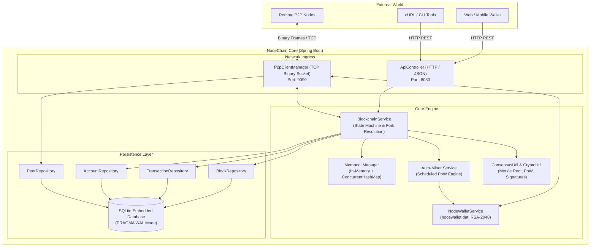
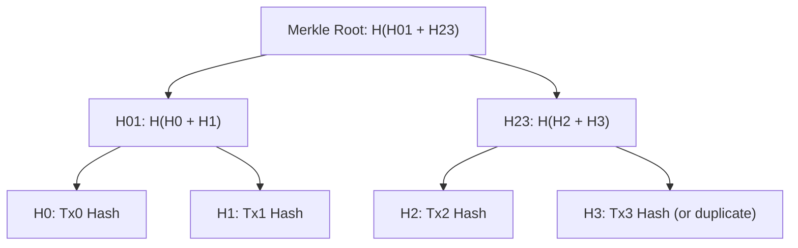
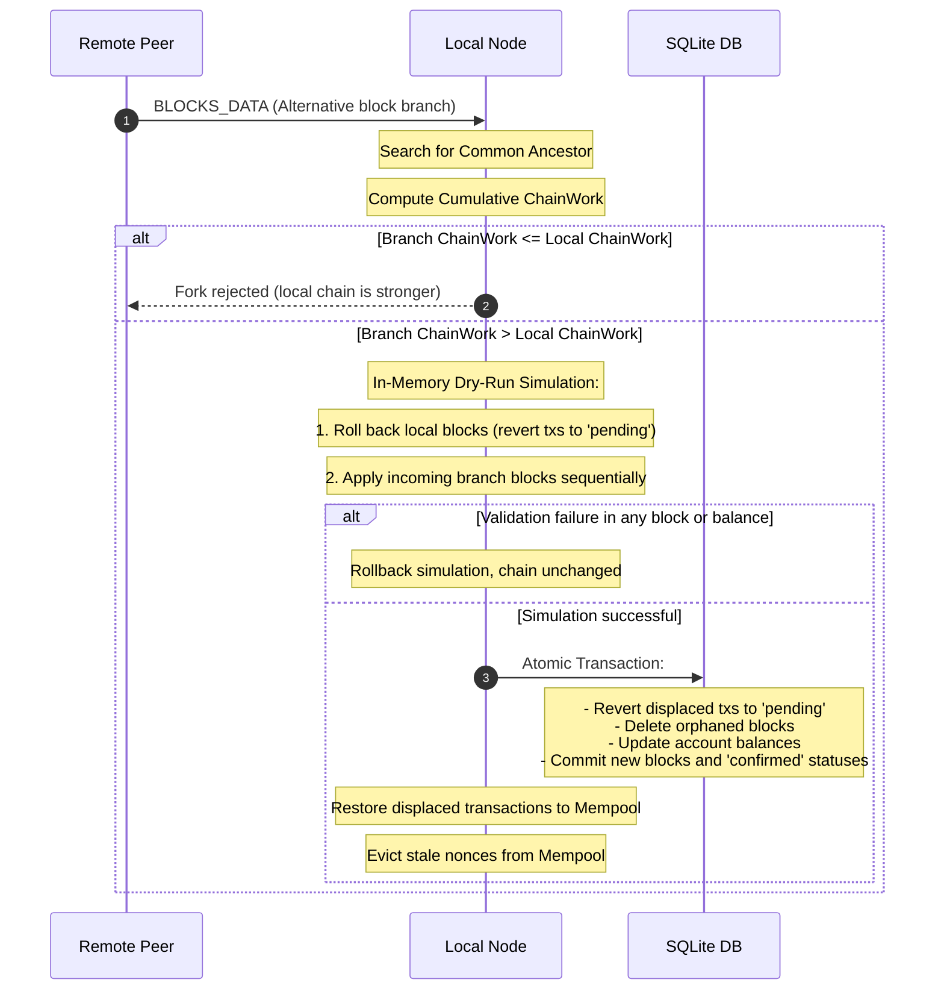

([перейти в Рус. версию](README.md))

# 🦊 NodeChain

<p align="center">
  
  
  
  
  
  
</p>

> **Full-featured distributed blockchain node built on Java 17 and Spring Boot.**
> Implemented without heavyweight external blockchain frameworks: pure JDK cryptography (`RSA-2048`, `SHA-256`), lightweight SQLite in WAL mode, custom binary P2P protocol with compression and overflow protection, and a strict REST API for client and wallet integrations.

---

## 📑 Table of Contents

- [Why and Who This Project Is For](#-why-and-who-this-project-is-for)
- [System Architecture](#-system-architecture)
- [Cryptography and Fox Addressing](#-cryptography-and-fox-addressing)
- [Account-Based Model](#-account-based-model)
- [Consensus: Proof-of-Work and Merkle Tree](#-consensus-proof-of-work-and-merkle-tree)
- [Chain Reorganization (Fork Choice & Reorg)](#-chain-reorganization-fork-choice--reorg)
- [Binary P2P Network Protocol](#-binary-p2p-network-protocol)
- [Data Layer: SQLite + HikariCP](#-data-layer-sqlite--hikaricp)
- [REST API v1 (Full Specification)](#-rest-api-v1-full-specification)
- [Configuration and Environment Variables](#-configuration-and-environment-variables)
- [Quick Start](#-quick-start)
  - [Building from Source](#building-from-source)
  - [Running a Single Node](#running-a-single-node)
  - [Running a Local Network (Multi-Node Testnet)](#running-a-local-network-multi-node-testnet)
- [Key Generation and Transaction Submission (CLI & Python)](#-key-generation-and-transaction-submission-cli--python)
- [Security Mechanisms](#-security-mechanisms)
- [Testing](#-testing)
- [Project Structure](#-project-structure)

---

## 💡 Why and Who This Project Is For

Most educational or lightweight blockchains suffer from one of two flaws:
1. Either a toy 200-line in-memory script lacking persistence, P2P networking, and signature validation.
2. Or monstrous monoliths (Hyperledger, Geth, Substrate), where transaction mathematics, consensus rules, and packet wire protocols are obscured behind excessive abstractions.

**NodeChain** is an honest, transparent, and engineered implementation of a decentralized node. No "magic" involved:
* 🏎️ **Zero Heavyweight Dependencies**: standard Java runtime cryptography (`java.security`).
* 📦 **Efficient Storage**: embedded SQLite database configured in high-performance WAL (`Write-Ahead Logging`) mode backed by HikariCP connection pooling.
* 🌐 **Real Binary P2P**: custom framing over raw TCP sockets featuring magic bytes, opcodes, mutual signed handshakes, and automatic GZIP compression for large block batches.
* 🛡️ **Exploit Resilience**: built-in protection against Transaction Malleability, mempool DoS eviction, GZIP bombs, timestamp replay attacks, and invalid nonces.

---

## 🏛 System Architecture

The node consists of cleanly separated subsystems designed around **Static-First & Clean Layers** principles:



---

## 🔐 Cryptography and Fox Addressing

### 1. Key Algorithm and Signatures
* **Asymmetric Algorithm**: `RSA-2048`.
* **Public Key Format**: X.509 ASN.1, encoded in `Base64`.
* **Private Key Format**: PKCS#8, encoded in `Base64`.
* **Digital Signature Algorithm**: `SHA256withRSA`.

### 2. Fox Address Format
Wallet addresses in NodeChain are **64-character strings** (`[0-9a-fox]{64}`), deterministically derived from the public key with brand symbols `'f'`, `'o'`, and `'x'` substituted in the prefix:

1. Calculate `SHA-256` hash of DER-encoded public key bytes (`PublicKey.getEncoded()`).
2. Convert the digest into a 64-character hex string.
3. The first 3 raw bytes of the digest dictate brand character positions:
   * Byte 0 selects the position for `'f'` (within index range `0..4`).
   * Byte 1 selects the position for `'o'` (range `0..4`, excluding `'f'`).
   * Byte 2 selects the position for `'x'` (range `0..4`, excluding `'f'` and `'o'`).

> **Valid Address Example:**  
> `f5ox17c91e0a29b2b2b1cf8813bc30e386abed50e82845bf13c8f8b8a531639d`

### 3. Canonical Signing Data Format (Anti-Malleability)
Transactions are strictly signed over a deterministic canonical string delimited by `|`:
- If comment is empty:  
  `from|to|amount|fee|nonce`
- If comment is present:  
  `from|to|amount|fee|nonce|comment`

The transaction hash is computed from:  
`from|to|amount|fee|nonce|comment|signature`

All addresses are normalized to **lowercase** prior to hashing and verification, preventing case-mismatched hash divergence.

---

## 👤 Account-Based Model

Unlike UTXO (Bitcoin model), NodeChain operates on an **Account-Based state model** (similar to Ethereum):

| Parameter | Description |
| :--- | :--- |
| **`address`** | Unique 64-character fox-address of the account. |
| **`balance`** | Confirmed balance in atomic units (`long`). 1 coin = $10^8$ atomic units. |
| **`nonce`** | Strictly monotonically increasing sequence counter of sent transactions (starts at `0`). |

### Nonce Handling Rules and Mempool Pipelining
* **Replay Protection**: a transaction is valid if and only if its `nonce` matches the sender's expected nonce.
* **Mempool Pipelining**: a sender can broadcast multiple sequential transactions into a single block:
  - `Tx_0` → nonce 0
  - `Tx_1` → nonce 1
  - `Tx_2` → nonce 2

  The node automatically chains them in memory and commits them sequentially.
* **Unconfirmed Balance**: incoming unconfirmed funds in the mempool **cannot be spent** before inclusion in a block. Attempts to spend unconfirmed incoming balances are rejected with `409 Conflict`.

---

## ⛏ Consensus: Proof-of-Work and Merkle Tree

### 1. Block Structure
```text
+--------------------------------------------------------------------------+
| Block Header                                                             |
|   height:        42                                                      |
|   previousHash:  00a8f93b...                                             |
|   merkleRoot:    7d2c418e...                                             |
|   minerAddress:  fox7a1bc...                                             |
|   timestamp:     1730912400000                                           |
|   nonce:         184729                                                  |
|   hash:          0004bca1... (starts with "0" * difficulty)              |
+--------------------------------------------------------------------------+
| Transactions [ tx0, tx1, tx2, ... ]                                      |
+--------------------------------------------------------------------------+
```

### 2. Proof-of-Work (PoW)
The miner increments the block `nonce` until the block hash satisfies difficulty criteria:
- **Block Payload** = `height|previousHash|merkleRoot|minerAddress|timestamp|nonce`
- **Block Hash** = `SHA256(Block Payload)`
- **Valid PoW** = `Block Hash` begins with `difficulty` leading zeros (`00...0`)

### 3. Merkle Tree
Transaction hashes are paired and hashed recursively bottom-up. If the count of nodes at any level is odd, the last hash is duplicated. For empty blocks, `merkleRoot = "0"`.



### 4. Bitcoin Core Subsidy Halving Algorithm
Emission of new coins follows the canonical Bitcoin Core halving formula:

- `halvings = height / halvingInterval`
- For `halvings >= 64`, subsidy equals strictly `0`
- Otherwise: `Subsidy = miningReward >> halvings`

Every `blockchain.halving-interval` blocks (default: 210,000), the base block reward is halved via bitwise right shift, enforcing a mathematical cap on total supply.

---

## 🔀 Chain Reorganization (Fork Choice & Reorg)

When a remote peer advertises a competing chain, the node resolves forks via the **Highest Cumulative Chain Work** rule:

**ChainWork** = sum of `16^difficulty` across all blocks in the branch



### Step-Back Fork Locator
If an incoming block batch does not connect to the tip of the local chain:
1. The node automatically steps back along the chain in increments of 20 blocks (`Math.max(1, lowestReceived - 20)`) and sends a `GET_BLOCKS` request.
2. Steps repeat until a locally known common ancestor is identified.
3. Upon verifying superior cumulative chain work (`branchWork > curWork`), the node executes simulation and an atomic `reorganizeChain`.

---

## 📡 Binary P2P Network Protocol

To eliminate overhead and maximize sync throughput, nodes communicate over a custom binary framing protocol via raw TCP sockets.

### 1. Wire Frame Layout

```text
 0                   1                   2                   3
 0 1 2 3 4 5 6 7 8 9 0 1 2 3 4 5 6 7 8 9 0 1 2 3 4 5 6 7 8 9 0 1
+-+-+-+-+-+-+-+-+-+-+-+-+-+-+-+-+-+-+-+-+-+-+-+-+-+-+-+-+-+-+-+-+
|          MAGIC (0x4658 "FX")          | FLAG  |               |
+-+-+-+-+-+-+-+-+-+-+-+-+-+-+-+-+-+-+-+-+-+-+-+-+-+-+-+-+-+-+-+-+
|                        REQUEST_ID                             |
+-+-+-+-+-+-+-+-+-+-+-+-+-+-+-+-+-+-+-+-+-+-+-+-+-+-+-+-+-+-+-+-+
|  OP_CODE  |                   PAYLOAD LENGTH                  |
+-+-+-+-+-+-+-+-+-+-+-+-+-+-+-+-+-+-+-+-+-+-+-+-+-+-+-+-+-+-+-+-+
|                                                               |
+                                                               +
|                      PAYLOAD BYTES                            |
+                     (JSON / GZIP)                             +
|                                                               |
+-+-+-+-+-+-+-+-+-+-+-+-+-+-+-+-+-+-+-+-+-+-+-+-+-+-+-+-+-+-+-+-+
```

| Field | Type | Size | Description |
| :--- | :--- | :--- | :--- |
| **`MAGIC`** | `short` | 2 bytes | Constant `0x4658` (ASCII `"FX"`). Packets with mismatching magic are immediately dropped. |
| **`FLAG`** | `byte` | 1 byte | `0x00` = RAW JSON, `0x01` = GZIP-compressed JSON. |
| **`REQUEST_ID`** | `int32` | 4 bytes | Request identifier for matching asynchronous responses. |
| **`OP_CODE`** | `byte` | 1 byte | Command operation code (see table below). |
| **`LENGTH`** | `int32` | 4 bytes | Length of the payload body in bytes (max **8 MiB**). |
| **`PAYLOAD`** | `byte[]` | `LENGTH` | Message payload in JSON format (compressed with GZIP if FLAG=1). |

### 2. Operation Codes Table (OpCodes)

| OpCode | Hex | Name | Purpose |
| :---: | :---: | :--- | :--- |
| **`1`** | `0x01` | `HANDSHAKE` | Initial greeting carrying cryptographic node signature. |
| **`2`** | `0x02` | `HANDSHAKE_ACK` | Mutual handshake acknowledgment with local chain state. |
| **`3`** | `0x03` | `PING` | Peer keep-alive check (dispatched every 20 seconds). |
| **`4`** | `0x04` | `PONG` | Heartbeat response (updates peer `last_seen` timestamp). |
| **`16`** | `0x10` | `GET_PEERS` | Request for list of active known network peers. |
| **`17`** | `0x11` | `PEERS_LIST` | Transmit known peer addresses (Gossip network discovery). |
| **`32`** | `0x20` | `GET_BLOCKS` | Request a batch of blocks from specified height (up to 100). |
| **`33`** | `0x21` | `BLOCKS_DATA` | Transmit array of block objects in response to `GET_BLOCKS`. |
| **`34`** | `0x22` | `NEW_BLOCK_ANNOUNCE` | Gossip broadcast of newly mined block across the network. |
| **`48`** | `0x30` | `NEW_TX_ANNOUNCE` | Gossip broadcast of new pending transaction to mempools. |

### 3. Cryptographic Handshake (Mutual Authentication)
Incoming TCP connections are sandboxed: until the remote node delivers a valid `HANDSHAKE`, any other packet triggers immediate socket termination.

**Handshake Message Payload:**
```json
{
  "nodeId": "f5ox17c91e0a29b2b2b1cf8813bc30e386abed50e82845bf13c8f8b8a531639d",
  "chainId": "foxchain-main-1",
  "height": 105,
  "latestBlockHash": "004aef72c81a...",
  "p2pPort": 9090,
  "version": "1.0.0",
  "timestamp": 1730912450123,
  "publicKey": "MIIBIjANBgkqhkiG9w0BAQEFAAOCAQ8A...",
  "signature": "kF8aZ19QW..."
}
```

* `nodeId` must strictly match the fox address calculated from `publicKey`.
* Signed data: `nodeId|chainId|height|latestBlockHash|p2pPort|timestamp`.
* Timestamp acceptance window: -60s to +120s from node's local clock (anti-replay guard).
* **Bidirectional Gossip**: upon accepting a connection, the node records the peer's listening `p2pPort` in the `peers` table and immediately triggers peer exchange via `GET_PEERS` / `PEERS_LIST`.

---

## 🗄 Data Layer: SQLite + HikariCP

The database runs on native `sqlite-jdbc` with fine-tuned parameters for blockchain workloads:

* **`PRAGMA journal_mode = WAL;`** - Write-Ahead Logging permits concurrent reads without blocking write transactions.
* **`PRAGMA synchronous = NORMAL;`** - optimal balance between durability and block commit latency.
* **`PRAGMA busy_timeout = 5000;`** - file lock acquisition timeout of up to 5 seconds to eliminate `SQLITE_BUSY`.
* **`maximumPoolSize = 1`** - single active connection pool prevents multi-threaded lock conflicts in SQLite at the JVM level.

### Database Schema

```sql
-- Blockchain blocks table
CREATE TABLE IF NOT EXISTS blocks (
  height INTEGER PRIMARY KEY,
  hash TEXT UNIQUE NOT NULL,
  previous_hash TEXT NOT NULL,
  merkle_root TEXT NOT NULL,
  miner_address TEXT NOT NULL,
  tx_count INTEGER NOT NULL,
  timestamp INTEGER NOT NULL,
  nonce INTEGER NOT NULL
);

-- Transactions table
CREATE TABLE IF NOT EXISTS transactions (
  hash TEXT PRIMARY KEY,
  block_height INTEGER,
  block_hash TEXT,
  tx_from TEXT NOT NULL,
  tx_to TEXT NOT NULL,
  amount INTEGER NOT NULL,
  fee INTEGER NOT NULL,
  nonce INTEGER NOT NULL,
  public_key TEXT NOT NULL,
  signature TEXT NOT NULL,
  comment TEXT,
  timestamp INTEGER NOT NULL,
  status TEXT NOT NULL,          -- 'pending' | 'confirmed' | 'failed'
  tx_index INTEGER DEFAULT 0     -- In-block position for Merkle Root validation
);

-- Indexes for pagination and history lookups
CREATE INDEX IF NOT EXISTS idx_tx_from ON transactions(tx_from);
CREATE INDEX IF NOT EXISTS idx_tx_to ON transactions(tx_to);
CREATE INDEX IF NOT EXISTS idx_tx_block_height ON transactions(block_height);
CREATE INDEX IF NOT EXISTS idx_tx_status ON transactions(status);

-- Account state ledger
CREATE TABLE IF NOT EXISTS accounts (
  address TEXT PRIMARY KEY,
  balance INTEGER NOT NULL,
  nonce INTEGER NOT NULL,
  updated_at INTEGER NOT NULL
);

-- Discovered network peers
CREATE TABLE IF NOT EXISTS peers (
  host TEXT NOT NULL,
  port INTEGER NOT NULL,
  last_seen INTEGER NOT NULL,
  PRIMARY KEY (host, port)
);
```

---

## 🌐 REST API v1 (Full Specification)

API listens by default on port `8080` with CORS support for web wallets and block explorers.

### 1. Address State
Returns confirmed balance, unconfirmed balance (accounting for pending outgoing transactions in mempool), current `nonce`, and total transaction count.

* **URL**: `GET /api/v1/addresses/{address}`
* **Request Example**:
  ```bash
  curl http://localhost:8080/api/v1/addresses/f5ox17c91e0a29b2b2b1cf8813bc30e386abed50e82845bf13c8f8b8a531639d
  ```
* **Success Response (200 OK)**:
  ```json
  {
    "address": "f5ox17c91e0a29b2b2b1cf8813bc30e386abed50e82845bf13c8f8b8a531639d",
    "balance": 100000000,
    "unconfirmedBalance": 99950000,
    "nonce": 1,
    "txCount": 1
  }
  ```
* **Errors**:
  * `400 Bad Request`: `{"code": 400, "message": "Некорректный формат адреса"}`
  * `404 Not Found`: `{"code": 404, "message": "Адрес еще не совершал транзакций и не имеет баланса"}`

---

### 2. Recommended Network Fee
Estimates required fee based on requested transaction priority.

* **URL**: `GET /api/v1/transactions/fee?priority={low|normal|high}` *(default: normal)*
* **Request Example**:
  ```bash
  curl http://localhost:8080/api/v1/transactions/fee?priority=high
  ```
* **Success Response (200 OK)**:
  ```json
  {
    "fee": 100,
    "priority": "high"
  }
  ```
  *(Values: `low` = 25, `normal` = 50, `high` = 100 atomic units)*

---

### 3. Mempool Contents
Inspects unconfirmed transactions currently queued for mining.

* **URL**: `GET /api/v1/transactions/mempool`
* **Request Example**:
  ```bash
  curl http://localhost:8080/api/v1/transactions/mempool
  ```
* **Success Response (200 OK)**:
  ```json
  {
    "count": 1,
    "transactions": [
      {
        "hash": "a4d3f2...",
        "from": "f5ox...",
        "to": "8fox...",
        "amount": 50000,
        "fee": 50,
        "nonce": 0,
        "publicKey": "MIIBIj...",
        "signature": "sig...",
        "comment": "Coffee payment",
        "timestamp": 1730912460000,
        "status": "pending"
      }
    ]
  }
  ```

---

### 4. Address Transaction History (with Pagination)
Returns list of incoming and outgoing transactions for an address, sorted by timestamp descending.

* **URL**: `GET /api/v1/addresses/{address}/transactions?limit={limit}&offset={offset}`
* **Query Parameters**:
  * `limit` (int, default: 25, clamped range: 1..100)
  * `offset` (int, default: 0, clamped range: 0..10000)
* **Request Example**:
  ```bash
  curl "http://localhost:8080/api/v1/addresses/f5ox.../transactions?limit=10&offset=0"
  ```
* **Success Response (200 OK)**:
  ```json
  {
    "total": 1,
    "txs": [
      {
        "hash": "e3b0c44298fc1c149afbf4c8996fb92427ae41e4649b934ca495991b7852b855",
        "from": "f5ox...",
        "to": "8fox...",
        "amount": 25000,
        "fee": 50,
        "comment": "Order #42 payment",
        "timestamp": 1730912000000,
        "status": "confirmed",
        "blockHeight": 12,
        "confirmations": 5
      }
    ]
  }
  ```

---

### 5. Send Signed Transaction
Validates cryptographic signature, sender balance, and sequential nonce, inserts transaction into local mempool, and broadcasts it to P2P peers.

* **URL**: `POST /api/v1/transactions/send`
* **Headers**: `Content-Type: application/json`
* **Request Body Parameters**:
  * `from` (*string*, required) — 64-character sender fox address.
  * `to` (*string*, required) — 64-character recipient fox address (must not equal `from`).
  * `amount` (*long*, required) — transfer amount in atomic units ($> 0$).
  * `fee` (*long*, optional, default: `50`) — network fee in atomic units ($\ge 0$).
  * `nonce` (*long*, required) — sequential transaction counter ($\ge 0$).
  * `publicKey` (*string*, required) — sender's public key in Base64 (X.509 ASN.1).
  * `signature` (*string*, required) — digital signature in Base64 (`SHA256withRSA`).
  * `comment` (*string*, optional, default: `""`, max 256 characters) — optional note.
* **Request Body**:
  ```json
  {
    "from": "f5ox17c91e0a29b2b2b1cf8813bc30e386abed50e82845bf13c8f8b8a531639d",
    "to": "8fox32a11b0e29b2b2b1cf8813bc30e386abed50e82845bf13c8f8b8a531639a",
    "amount": 10000,
    "fee": 50,
    "nonce": 0,
    "publicKey": "MIIBIjANBgkqhkiG9w0BAQEFAAOCAQ8AMIIBCgKCAQEA0...",
    "signature": "Yh31Z+QJ8k2...",
    "comment": "Transfer to friend"
  }
  ```
* **Success Response (200 OK)**:
  ```json
  {
    "hash": "c83b8a1e2d4...",
    "status": "pending",
    "addedAt": 1730912500123,
    "nonce": 0,
    "fee": 50
  }
  ```
* **Standard Error Responses**:
  * `400 Bad Request`: `{"code": 400, "message": "Подпись не верна"}` or `{"code": 400, "message": "Некорректный формат адреса"}`
  * `400 Bad Request`: `{"code": 400, "message": "Некорректный формат данных в теле запроса"}` (invalid JSON, type mismatch, or float value)
  * `409 Conflict`: `{"code": 409, "message": "Недостаточно средств"}`
  * `409 Conflict`: `{"code": 409, "message": "Конфликт nonce"}`
  * `409 Conflict`: `{"code": 409, "message": "Транзакция отклонена: отправка самому себе"}`
  * `409 Conflict`: `{"code": 409, "message": "Транзакция отклонена: слишком длинный комментарий"}`
  * `409 Conflict`: `{"code": 409, "message": "Транзакция отклонена: некорректная сумма"}` / `"некорректная комиссия"`
  * `409 Conflict`: `{"code": 409, "message": "Транзакция отклонена: переполнение суммы и комиссии"}`
  * `409 Conflict`: `{"code": 409, "message": "Транзакция отклонена"}` (missing required fields)
  * `415 Unsupported Media Type`: `{"code": 415, "message": "Неподдерживаемый тип медиа"}` (non-JSON Content-Type)
  * `429 Too Many Requests`: `{"code": 429, "message": "Mempool переполнен"}`

---

### 6. View Transaction by Hash
* **URL**: `GET /api/v1/transactions/{txHash}`
  * `{txHash}` is strictly constrained to a 64-character hexadecimal pattern (`[a-fA-F0-9]{64}`), avoiding route collisions with `/transactions/*`.
* **Request Example**:
  ```bash
  curl http://localhost:8080/api/v1/transactions/c83b8a1e2d4...
  ```
* **Success Response (200 OK)**:
  ```json
  {
    "hash": "c83b8a1e2d4...",
    "from": "f5ox...",
    "to": "8fox...",
    "amount": 10000,
    "fee": 50,
    "comment": "Transfer to friend",
    "timestamp": 1730912500123,
    "status": "confirmed",
    "blockHeight": 14,
    "blockHash": "00a94bf1...",
    "confirmations": 2
  }
  ```
* **Errors**: `404 Not Found`: `{"code": 404, "message": "Транзакция отсутствует"}`

---

### 7. Get Block (by Height, Hash or 'latest')
Universal endpoint for inspecting chain blocks.

* **URL**: `GET /api/v1/blocks/{identifier}`
  * `{identifier}` accepts a numeric height (`0`, `1`, `42`), the keyword `latest`, or a 64-character block hash.
* **Request Example**:
  ```bash
  curl http://localhost:8080/api/v1/blocks/latest
  curl http://localhost:8080/api/v1/blocks/0
  ```
* **Success Response (200 OK)**:
  ```json
  {
    "height": 0,
    "hash": "e6a1...",
    "previousHash": "0",
    "merkleRoot": "0",
    "minerAddress": "GENESIS",
    "nonce": 0,
    "txCount": 0,
    "timestamp": 0,
    "transactions": []
  }
  ```
* **Errors**: `404 Not Found`: `{"code": 404, "message": "Блок отсутствует"}`

---

### 8. Network State and Sync Status
* **URL**: `GET /api/v1/network`
* **Request Example**:
  ```bash
  curl http://localhost:8080/api/v1/network
  ```
* **Success Response (200 OK)**:
  ```json
  {
    "chainId": "foxchain-main-1",
    "height": 42,
    "latestBlockHash": "0002ab1f592...",
    "peers": 4,
    "isSynced": true,
    "version": "1.0.0"
  }
  ```

---

## ⚙ Configuration and Environment Variables

NodeChain supports a two-tier configuration hierarchy:
1. Default values packaged inside `application.properties`.
2. User overrides in `./server.properties` (automatically generated on first run in working directory).
3. System environment variables or Spring Boot command line parameters.

### Available Configuration Parameters

| Parameter | Default | Description |
| :--- | :---: | :--- |
| **`server.port`** | `8080` | HTTP port for the client REST API. |
| **`node.p2p.port`** | `9090` | TCP port for incoming binary P2P connections. |
| **`node.db.path`** | `sqlite.db` | File path for the SQLite database. |
| **`blockchain.chain-id`** | `foxchain-main-1` | Unique network ID (peers with different IDs are dropped). |
| **`blockchain.difficulty`** | `2` | Leading zero count required for block PoW (range: 1–32). |
| **`blockchain.mining-reward`** | `100000000` | Miner reward for minted block (in atomic units). |
| **`blockchain.auto-mine`** | `true` | Enables automatic background mining when mempool has txs. |
| **`blockchain.mine-interval-seconds`**| `10` | Mempool poll and mine attempt interval (in seconds). |
| **`blockchain.max-mempool-size`** | `10000` | Maximum number of pending transactions in memory. |
| **`blockchain.genesis-allocation`** | `1000000000000` | Initial Genesis allocation (10,000 FOXT in atomic units). |
| **`blockchain.genesis-address`** | *(empty)* | Target pre-mine address (defaults to node wallet `nodewallet.dat`). |
| **`blockchain.halving-interval`** | `210000` | Halving period in blocks (reward halves every N blocks). |
| **`node.p2p.seeds`** | *(empty)* | Comma-separated seed peers: `127.0.0.1:9091,192.168.1.50:9090`. |

> **Example `server.properties` for a second local node:**
> ```properties
> server.port=8081
> node.p2p.port=9091
> node.db.path=node2.db
> node.p2p.seeds=127.0.0.1:9090
> ```

---

## 🚀 Quick Start

### Requirements
* **JDK 17+** (Eclipse Temurin, OpenJDK or Oracle)
* **Apache Maven 3.8+**

### Building from Source
Clone the repository and build an executable Fat JAR:

```bash
# Clone
git clone https://github.com/foxso/nodechain.git
cd nodechain

# Build without tests
mvn clean package -DskipTests

# Run full integration and consensus test suite
mvn test
```
The compiled JAR is generated at `target/node.jar`.

---

### Running a Single Node

```bash
mkdir -p testnet && cd testnet
cp ../target/node.jar .

java -jar node.jar
```

On first launch, the node executes the following bootstrap sequence:
1. Generates `server.properties` with default overrides if missing.
2. Creates an RSA-2048 keypair and saves the miner wallet to `nodewallet.dat`.
3. Initializes SQLite schema in `sqlite.db` and writes deterministic Genesis Block #0.
4. Opens binary P2P server on port `9090` and REST API on port `8080`.
5. Starts the auto-miner service assembling pending transactions into blocks.

Verify the node status:
```bash
curl http://localhost:8080/api/v1/network
```

---

### Running a Local Network (Multi-Node Testnet)

Launch two nodes on a single host that discover, authenticate, and sync with each other:

```bash
# Terminal 1: Seed Node
mkdir -p testnet/node1 && cd testnet/node1
cp ../../target/node.jar .
java -jar node.jar --server.port=8080 --node.p2p.port=9090 --node.db.path=node1.db
```

```bash
# Terminal 2: Peer Node
mkdir -p testnet/node2 && cd testnet/node2
cp ../../target/node.jar .
java -jar node.jar \
  --server.port=8081 \
  --node.p2p.port=9091 \
  --node.db.path=node2.db \
  --node.p2p.seeds=127.0.0.1:9090
```

Within a second, both consoles will report mutual cryptographic handshake verification:
```text
Registered incoming P2P peer connection: 127.0.0.1:9091
P2P peer verified & handshake confirmed for node f5ox...
```

---

## 🛠 Key Generation and Transaction Submission (CLI & Python)

Because NodeChain nodes operate on a non-custodial model, transactions must be signed client-side.

Below is a complete **Python 3** script that generates an RSA-2048 keypair, calculates the fox address, signs a transaction canonically, and submits it to the node REST API:

<details>
<summary>▶ Show transaction submission script (<code>wallet_client.py</code>)</summary>

```python
import base64
import hashlib
import json
import urllib.request
from cryptography.hazmat.primitives.asymmetric import rsa, padding
from cryptography.hazmat.primitives import hashes, serialization

# 1. Generate RSA-2048 Keypair
private_key = rsa.generate_private_key(public_exponent=65537, key_size=2048)
public_key = private_key.public_key()

# 2. Export public key to Base64 (X.509 DER)
pub_der = public_key.public_bytes(
    encoding=serialization.Encoding.DER,
    format=serialization.PublicFormat.SubjectPublicKeyInfo
)
pub_b64 = base64.b64encode(pub_der).decode("utf-8")

# 3. Derive Fox Address
raw_sha = hashlib.sha256(pub_der).digest()
addr_chars = list(hashlib.sha256(pub_der).hexdigest())

pos_f = raw_sha[0] % 5
pos_o = raw_sha[1] % 5
while pos_o == pos_f:
    pos_o = (pos_o + 1) % 5
pos_x = raw_sha[2] % 5
while pos_x == pos_f or pos_x == pos_o:
    pos_x = (pos_x + 1) % 5

addr_chars[pos_f] = 'f'
addr_chars[pos_o] = 'o'
addr_chars[pos_x] = 'x'
sender_address = "".join(addr_chars).lower()

print(f"[*] Generated Fox Address: {sender_address}")

# 4. Build Transaction
recipient_address = "fox0000000000000000000000000000000000000000000000000000000000000" # valid recipient
amount = 10000
fee = 50
nonce = 0
comment = "Hello from Python Client!"

# Canonical signing string (handles presence or absence of comment)
canonical = (
    f"{sender_address}|{recipient_address}|{amount}|{fee}|{nonce}|{comment}"
    if comment
    else f"{sender_address}|{recipient_address}|{amount}|{fee}|{nonce}"
)

# 5. Sign with SHA256withRSA
signature_bytes = private_key.sign(
    canonical.encode("utf-8"),
    padding.PKCS1v15(),
    hashes.SHA256()
)
sig_b64 = base64.b64encode(signature_bytes).decode("utf-8")

payload = {
    "from": sender_address,
    "to": recipient_address,
    "amount": amount,
    "fee": fee,
    "nonce": nonce,
    "publicKey": pub_b64,
    "signature": sig_b64,
    "comment": comment
}

# 6. Submit to node via REST API
req = urllib.request.Request(
    "http://localhost:8080/api/v1/transactions/send",
    data=json.dumps(payload).encode("utf-8"),
    headers={"Content-Type": "application/json"}
)

try:
    with urllib.request.urlopen(req) as resp:
        print("[+] Node response:", resp.read().decode("utf-8"))
except urllib.error.HTTPError as e:
    print(f"[-] Submission error ({e.code}):", e.read().decode("utf-8"))
```
</details>

---

## 🛡 Security Mechanisms

NodeChain implements algorithmic defenses against common blockchain attacks:

1. **Transaction Malleability Protection**:
   Signatures are applied strictly over a canonical delimiter-separated argument string. No extraneous metadata or comment injections can be altered without invalidating the RSA signature.
2. **DoS Mempool Eviction Protection (Tail Nonce Rule)**:
   When reaching `maxMempoolSize`, transactions with lower fees can only be evicted if they are **tail nonces**. Evicting `nonce 0` is prohibited if dependent transactions (`nonce 1`, `nonce 2`) exist in mempool. Accounts with zero balance cannot displace valid transactions.
3. **Network GZIP Bomb Defense**:
   `NodePacket.decompressGzip` enforces a strict decompression threshold. If uncompressed stream exceeds 8 MiB, decompression aborts immediately with an I/O exception.
4. **Arithmetic Overflow Protection**:
   All balance additions and subtractions for transactions, fees, and mining rewards utilize `Math.addExact()` and `Math.subtractExact()`. Negative values or inputs overflowing `Long.MAX_VALUE` trigger consensus errors.
5. **Timestamp Drift Protection**:
   Blocks carrying timestamps from the distant future ($>10$ minutes) or older than the previous block are rejected instantly.
6. **Per-Port & Per-Opcode Rate Limiting**:
   Incoming network packets are rate-limited per `IP:port:opcode`. Block synchronization requests have a 10 ms window; administrative commands have a 100 ms window.
7. **Global Exception Handling & 500 Immunity (API Robustness)**:
   All HTTP requests pass through `GlobalExceptionHandler`. Syntax errors in JSON payloads, type mismatches, invalid Content-Types, or unsupported HTTP methods return strict client errors (`400 Bad Request`, `405 Method Not Allowed`, `415 Unsupported Media Type`, `409 Conflict`), preventing uncaught `500 Internal Server Error` responses.
8. **Node Wallet Integrity Self-Test (Challenge-Response)**:
   During bootstrap, `NodeWalletService` validates the keypair by signing a test payload (`challenge-nodewallet.dat`). Any file corruption or key mismatch halts node startup prior to opening network ports, preventing miner reward loss.
9. **Anti-Float Coercion Protection**:
   Jackson deserialization disables float-to-integer coercion (`featuresToDisable(ACCEPT_FLOAT_AS_INT)` and `spring.jackson.deserialization.accept-float-as-int=false`). Fractional inputs in amounts or fees are rejected immediately with `400 Bad Request`.

---

## 🧪 Testing

The codebase is covered by comprehensive integration and fuzzing suites (totaling **64 tests** passing with zero failures):

```bash
# Run all project tests
mvn test
```

### Key Test Suites:
* `BlockchainIntegrationTest.java` (21 tests):
  * Comprehensive testing of all 8+ REST API endpoints via Spring `MockMvc`.
  * Complete lifecycle: transaction submission $\rightarrow$ mining $\rightarrow$ balance and nonce progression.
  * Automatic chain reorganization when encountering a fork with higher chainwork.
  * Verification that unconfirmed incoming funds cannot be spent.
  * Transaction fee-priority sorting in miner.
  * Mempool Pipelining: sequential broadcast of chained transactions with ascending nonces.
* `ClientApiFuzzAndRobustnessTest.java` (13 tests, 50+ fuzzing scenarios):
  * Extensive fuzzing and edge-case testing of the REST API against malformed or hostile inputs.
  * Numerical overflow, floating-point inputs, empty bodies, and missing fields.
  * Boundary limits (pagination clamps, comment length $>256$ chars, case-insensitivity of addresses).
  * Injection attempts (SQLi, null bytes) and unsupported HTTP methods / Content-Types.
  * Confirmed API resilience: zero crashes into `500 Internal Server Error`.
* `MultiNodeNetworkTest.java` (10 tests):
  * Integration tests of a real P2P cluster composed of 2 and 3 independent nodes running on distinct ports and SQLite databases.
  * Mutual authentication and cryptographic handshake with RSA signatures.
  * Mempool transaction synchronization via Gossip (`NEW_TX_ANNOUNCE`).
  * Real-time propagation of newly mined blocks (`NEW_BLOCK_ANNOUNCE`).
  * Fast-Sync (Initial Block Download, IBD) for joining nodes using batched `GET_BLOCKS`.
  * Automatic fork reorganization (Chain Reorg) based on cumulative chainwork.
  * Byzantine resilience: isolation and rejection of peers broadcasting invalid blocks.
  * Multi-hop mesh relaying through intermediate nodes.
  * Peer discovery via `GET_PEERS` / `PEERS_LIST` and recovery after disconnects.
  * Isolation of networks with mismatching `chainId`.
* `ConsensusAndSecurityTest.java` (16 tests):
  * Miner thread interruption and graceful termination.
  * In-block duplicate transaction rejection.
  * GZIP bomb defense and unknown packet flag handling.
  * P2P handshake replay window and unauthorized packet rejection.
  * Wallet file corruption recovery and challenge validation.
  * Bitcoin Core subsidy halving schedule verification.
  * Tail nonce eviction rules in saturated mempools.
* `CryptoUtilTest.java` (2 tests):
  * Correctness of 64-character fox-address generation and brand character placement.
  * RSA-2048 (`SHA256withRSA`) signature generation and verification.
* `NodePacketTest.java` (2 tests):
  * Binary framing serialization and deserialization with MAGIC.
  * Automatic GZIP compression threshold for payloads $>128$ bytes.

---

## 📂 Project Structure

```text
nodechain/
├── pom.xml                   # Maven build configuration (Java 17, Spring Boot 3.3.5)
├── README.md                 # Project documentation (Russian)
├── README_EN.md              # Project documentation (English)
├── nodewallet.dat            # Node keys (RSA-2048) and fox address
├── server.properties         # Local user configuration overrides
├── src/main/java/so/fox/nodechain/
│   ├── NodechainApplication.java   # Spring Boot entry point
│   ├── api/
│   │   ├── ApiController.java      # REST API v1 public endpoints
│   │   └── GlobalExceptionHandler.java # API error handler (400, 405, 415)
│   ├── config/
│   │   ├── DatabaseConfig.java     # SQLite WAL DataSource & HikariCP
│   │   └── NodeConfig.java         # Node parameters and consensus validation
│   ├── core/
│   │   ├── BlockchainService.java  # Mempool, mining, forks, and balances
│   │   ├── ConsensusUtil.java      # Consensus rules, PoW, and Merkle tree
│   │   ├── NodeWalletService.java  # RSA wallet management and challenge test
│   │   └── Result.java             # Monolithic typed result (Errors as Values)
│   ├── crypto/
│   │   └── CryptoUtil.java         # RSA-2048, SHA-256, and fox addressing
│   ├── model/
│   │   ├── Account.java            # Account state model (balance, nonce)
│   │   ├── Block.java              # Block model (header, PoW, Merkle root)
│   │   ├── PeerInfo.java           # Network peer metadata
│   │   └── Transaction.java        # Transaction model, canonical hash, sig
│   ├── p2p/
│   │   ├── P2pClientManager.java   # TCP server, Gossip, and chain sync
│   │   ├── PeerConnection.java     # Active TCP peer connection
│   │   └── packet/
│   │       ├── NodePacket.java     # Binary frame with GZIP compression
│   │       └── OpCode.java         # Protocol command operation codes
│   └── repository/
│       ├── AccountRepository.java  # Account balances and nonces in SQLite
│       ├── BlockRepository.java    # Chain blocks repository in SQLite
│       ├── PeerRepository.java     # Discovered peers table
│       └── TransactionRepository.java # Transaction history and mempool
├── src/main/resources/
│   └── application.properties      # Default application properties
└── src/test/java/so/fox/nodechain/
    ├── BlockchainIntegrationTest.java      # API, mining, and reorg tests
    ├── ClientApiFuzzAndRobustnessTest.java # API fuzzing and 500 error defense
    ├── ConsensusAndSecurityTest.java       # Security, P2P, and PoW tests
    ├── CryptoUtilTest.java                 # Crypto and address unit tests
    ├── MultiNodeNetworkTest.java           # Multi-node P2P cluster tests
    └── NodePacketTest.java                 # Binary protocol framing tests
```

---

<p align="center">
  Crafted with ❤️ and attention to detail. No clutter, only clean architecture and robust code.
</p>

