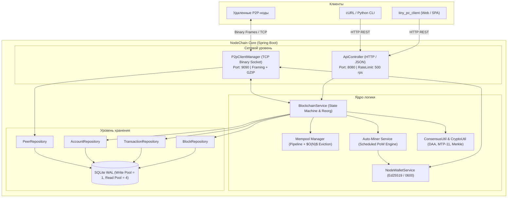

([go to Eng. ver](README.EN.md))

# 🦊 NodeChain

<p align="center">
  
  
  
  
  
  
  
</p>

> **Полнофункциональная распределенная блокчейн-нода на Java 17 и Spring Boot.**
> Чистая криптография JDK (`Ed25519`, `SHA-256`, `RFC 6962 Merkle Tree`), встроенный SQLite в режиме WAL, бинарный P2P-протокол со сжатием GZIP, строгий REST API с Token Bucket защитой и автономный веб-клиент `tiny_pc_client` (Mithril.js + Web Crypto API).

---

## 📑 Содержание

- [Архитектура](#-архитектура)
- [Криптография и адресация](#-криптография-и-адресация)
- [Консенсус и правила сети](#-консенсус-и-правила-сети)
- [Бинарный P2P-протокол](#-бинарный-p2p-протокол)
- [Слой данных: SQLite WAL](#-слой-данных-sqlite-wal)
- [REST API v1](#-rest-api-v1)
- [Веб-клиент (tiny_pc_client)](#-веб-клиент-tiny_pc_client)
- [Конфигурация](#-конфигурация)
- [Быстрый старт](#-быстрый-старт)
- [Пример клиента на Python](#-пример-клиента-на-python)
- [Безопасность и защита](#-безопасность-и-защита)
- [Структура проекта](#-структура-проекта)

---

## 🏛 Архитектура

Система построена по слоистой модели **Static-First & Clean Layers**:



---

## 🔐 Криптография и адресация

### 1. Ключи и подписи (Ed25519)
* **Алгоритм**: `Ed25519` (RFC 8032) на нативном провайдере `java.security`.
* **Public Key**: DER X.509 SPKI (44 байта), Base64 (60 символов).
* **Private Key**: DER PKCS#8 (48 байт), Base64 (64 символа). Файл `nodewallet.dat` сохраняется с правами `0600` (`rw-------`).
* **Signature**: Бинарная (64 байта), Base64 (88 символов).

### 2. Формат Fox-адреса и CRC32 Checksum
Адрес кошелька — **64 hex-символа** с брендовыми буквами `'f'`, `'o'`, `'x'` в первых 5 символах и контрольной суммой:
1. `hash = SHA256(PublicKey.getEncoded())`.
2. Первые 3 байта определяют позиции для `'f'`, `'o'`, `'x'` в диапазоне индексов `0..4`.
3. Символы `0..55` — полезная нагрузка адреса (`payload`).
4. Символы `56..63` (последние 8 hex) — контрольная сумма `CRC32` (IEEE 802.3) от payload. Проверяется через `CryptoUtil.isValidAddress()`.

> **Пример адреса:** `6foxabbe6c0d624d0bb3de4c8375643f4fce0c9744c0096f14b919dfe3f031f1`

### 3. Канонический формат данных для подписи
Для защиты от Transaction Malleability и Cross-Chain Replay подпись накладывается строго на каноническую строку (разделитель `|`):
* Без комментария:  
  `chainId|from|to|amount|fee|nonce|timestamp`
* С комментарием:  
  `chainId|from|to|amount|fee|nonce|timestamp|comment.trim()`

**Хеш транзакции (SHA-256):**  
`SHA256(chainId|from|to|amount|fee|nonce|timestamp|comment.trim()|signature)`

---

## ⛏ Консенсус и правила сети

* **Модель учетных записей (Account-Based)**: `address`, `balance` ($10^8$ атомов = 1 монета), `nonce`.
* **Mempool Pipelining**: отправитель может отправлять транзакции с возрастающим `nonce` подряд; неподтвержденные средства тратить запрещено (`409 Conflict`).
* **Минимальная комиссия (`MIN_RELAY_FEE`)**: `1L` атом для защиты от спама.
* **Proof-of-Work**: Хеш блока `SHA256(height|chainId|previousHash|merkleRoot|minerAddress|timestamp|difficulty|nonce)` должен начинаться с `difficulty` hex-нулей.
* **DAA (Difficulty Adjustment)**: пересчет каждые `blockchain.difficulty-adjustment-interval` блоков (дефолт 10) под целевое время (`target-block-time-seconds = 10`).
* **MTP-11 и временные метки**: метка времени блока обязана быть $> \text{MTP-11}$ предыдущих блоков и $\le \text{now} + 30\text{с}$. Алгоритм DAA оперативно повышает сложность при ускорении майнинга.
* **Сетевые чекпоинты**: параметр `blockchain.checkpoints=<height>:<hash>,...` блокирует альтернативные ветки при несовпадении хеша на заданной высоте.
* **Дерево Меркла (RFC 6962)**: доменное разделение — листья хешируются с префиксом `00`, внутренние узлы с `01`.
* **Халвинг эмиссии**: каждые `blockchain.halving-interval` блоков (210 000) награда уменьшается вдвое: `Subsidy = miningReward >> (height / halvingInterval)`. При $\ge 64$ халвингах награда равна 0.
* **Реорганизация цепи (Fork Choice)**: выбор ветки по наибольшей кумулятивной работе ($\sum 16^{\text{difficulty}}$). Лимит глубины отката `MAX_REORG_DEPTH = 3` блока.

---

## 📡 Бинарный P2P-протокол

Ноды обмениваются фреймами по кастомному протоколу поверх прямого TCP-сокета:

```text
 0                   1                   2                   3
 0 1 2 3 4 5 6 7 8 9 0 1 2 3 4 5 6 7 8 9 0 1 2 3 4 5 6 7 8 9 0 1
+-+-+-+-+-+-+-+-+-+-+-+-+-+-+-+-+-+-+-+-+-+-+-+-+-+-+-+-+-+-+-+-+
|          MAGIC (0x4658 "FX")          | FLAG  |               |
+-+-+-+-+-+-+-+-+-+-+-+-+-+-+-+-+-+-+-+-+-+-+-+-+-+-+-+-+-+-+-+-+
|                        REQUEST_ID                             |
+-+-+-+-+-+-+-+-+-+-+-+-+-+-+-+-+-+-+-+-+-+-+-+-+-+-+-+-+-+-+-+-+
|  OP_CODE  |                   PAYLOAD LENGTH                  |
+-+-+-+-+-+-+-+-+-+-+-+-+-+-+-+-+-+-+-+-+-+-+-+-+-+-+-+-+-+-+-+-+
|                      PAYLOAD BYTES (JSON / GZIP)              |
+-+-+-+-+-+-+-+-+-+-+-+-+-+-+-+-+-+-+-+-+-+-+-+-+-+-+-+-+-+-+-+-+
```

| Поле | Байт | Описание |
| :--- | :---: | :--- |
| **`MAGIC`** | 2 | Сигнатура `0x4658` (ASCII `"FX"`). |
| **`FLAG`** | 1 | `0x00` = Raw JSON, `0x01` = GZIP (автосжатие при $>128$ байт). |
| **`REQUEST_ID`** | 4 | Идентификатор корреляции запроса и ответа. |
| **`OP_CODE`** | 1 | Команда сетевого протокола. |
| **`LENGTH`** | 4 | Размер тела (лимит: 16 Б для PING/PONG, 64 КиБ для контроля, 4 МиБ для блоков). |

### Коды операций (OpCodes)

| OpCode | Hex | Название | Описание |
| :---: | :---: | :--- | :--- |
| **1** | `0x01` | `HANDSHAKE` | Подписанное приветствие с `sessionNonce` против Replay. |
| **2** | `0x02` | `HANDSHAKE_ACK` | Подтверждение рукопожатия и статус локальной цепи. |
| **3** | `0x03` | `PING` | Keep-alive пинг (каждые 20 с). |
| **4** | `0x04` | `PONG` | Ответ на пинг с высотой цепи. |
| **16** | `0x10` | `GET_PEERS` | Запрос таблицы известных узлов сети. |
| **17** | `0x11` | `PEERS_LIST` | Gossip-ответ со списком активных пиров. |
| **32** | `0x20` | `GET_BLOCKS` | Запрос блоков (пакеты до 10 блоков). |
| **33** | `0x21` | `BLOCKS_DATA` | Передача массива блоков. |
| **34** | `0x22` | `NEW_BLOCK_ANNOUNCE` | Gossip-бродкаст свежесмайненного блока. |
| **48** | `0x30` | `NEW_TX_ANNOUNCE` | Gossip-бродкаст транзакции в мемпулы. |

**Лимиты и защита сети:**
* Квота соединений: максимум 64 (из них входящих — до 48, резерв 16 слотов для честных исходящих узлов).
* Ограничение: не более 2 подключений с одного внешнего IP; лимит транзакций: 5000 tx/s на пира.
* SSRF-фильтр (`isSafePeerAddress`): запрет приватных сетей RFC 1918, системных портов и метаданных облаков (`169.254.0.0/16`).
* Защита от Eclipse-атак и загрязнения БД: адреса из gossip (`PEERS_LIST`) сохраняются только в in-memory очередь кандидатов (`candidatePeers`); запись в таблицу `peers` происходит исключительно после успешного Ed25519-рукопожатия (`handleHandshake`).
* Дедлайн чтения фрейма: 10 секунд (защита от Slowloris DoS).
* Лимит распаковки GZIP: жесткий потолок 4 МиБ (защита от декомпрессионных бомб).

---

## 🗄 Слой данных: SQLite WAL

БД работает на нативном `sqlite-jdbc` с разделением пулов соединений **HikariCP**:
* **Пул записи (Write Pool = 1)**: одно выделенное соединение во избежание взаимных блокировок и ошибок `SQLITE_BUSY`.
* **Пул чтения (Read Pool = 4)**: до 4 параллельных неблокирующих читателей в режиме WAL с `PRAGMA query_only = ON;`.
* `PRAGMA journal_mode = WAL;` — неблокирующее параллельное чтение во время транзакций записи.
* `PRAGMA synchronous = NORMAL;` — высокая производительность при надежной фиксации на диск.
* `PRAGMA busy_timeout = 10000;` — ожидание освобождения блокировок файла до 10 секунд.
* Параметры инициализируются на каждом соединении через `connectionInitSql`.

Таблицы: `blocks` (история цепи), `transactions` (реестр транзакций), `accounts` (балансы и nonces) и `peers` (проверенные узлы).

---

## 🌐 REST API v1

Порт по умолчанию: `8080`.
* **CORS**: разрешены `Origin: null` (для запуска клиента через `file://`) и локальные порты (`http://localhost:[*]`, `http://127.0.0.1:[*]`).
* **Rate Limiter**: Token Bucket на реальный IP сокета (`500` токенов, восполнение `10 мс`, статус `429 Too Many Requests`).
* **Strict Type Safety**: Jackson настроен с `accept-float-as-int=false` (дробные числа в суммах/комиссиях отклоняются с кодом `400`).

### Эндпоинты

#### 1. Состояние адреса: `GET /api/v1/addresses/{address}`
```json
{
  "address": "6foxabbe6c0d624d0bb3de4c8375643f4fce0c9744c0096f14b919dfe3f031f1",
  "balance": 100000000,
  "unconfirmedBalance": 99950000,
  "nonce": 1,
  "txCount": 1,
  "nextPendingNonce": 2
}
```

#### 2. Рекомендуемая комиссия: `GET /api/v1/transactions/fee?priority={low|normal|high}`
Возвращает рекомендуемую комиссию (`low`: 25, `normal`: 50, `high`: 100 атомов).

#### 3. Очередь Mempool: `GET /api/v1/transactions/mempool?limit=100&offset=0`
Возвращает количество и список транзакций в очереди памяти с поддержкой пагинации.

#### 4. История транзакций адреса: `GET /api/v1/addresses/{address}/transactions?limit=25&offset=0`
```json
{
  "total": 1,
  "txs": [
    {
      "hash": "c83b8a1e2d4...",
      "from": "6fox...",
      "to": "8fox...",
      "amount": 10000,
      "fee": 50,
      "comment": "Оплата заказа",
      "timestamp": 1730912500000,
      "status": "confirmed",
      "blockHeight": 14,
      "confirmations": 3
    }
  ]
}
```

#### 5. Отправка транзакции: `POST /api/v1/transactions/send`
*Content-Type: application/json*
```json
{
  "chainId": "foxchain-main-1",
  "from": "6foxabbe6c0d624d0bb3de4c8375643f4fce0c9744c0096f14b919dfe3f031f1",
  "to": "8fox32a11b0e29b2b2b1cf8813bc30e386abed50e82845bf13c8f8b8a531639a",
  "amount": 10000,
  "fee": 50,
  "nonce": 0,
  "timestamp": 1730912500000,
  "publicKey": "MCowBQYDK2VwAyEA4Q8w8i02w9Gk2h6H2M7lFk4mP0...",
  "signature": "81c03fa99b1a7d6e5c4b3a2f1e0d9c8b7a6f5e4d3c2b1a0f...",
  "comment": "Оплата"
}
```
**Успех (200 OK):** `{"hash": "c83b8a1e...", "status": "pending", "addedAt": 1730912500000, "nonce": 0, "fee": 50}`

#### 6. Транзакция по хешу: `GET /api/v1/transactions/{txHash:[a-fA-F0-9]{64}}`
Возвращает детали транзакции, статус (`pending`/`confirmed`), номер и хеш блока, число подтверждений.

#### 7. Блок по номеру или хешу: `GET /api/v1/blocks/{identifier}`
`{identifier}`: номер высоты (`0`, `1`), хеш блока или псевдоним `latest`.

#### 8. Состояние ноды: `GET /api/v1/network`
```json
{
  "chainId": "foxchain-main-1",
  "height": 42,
  "latestBlockHash": "0002ab1f592...",
  "peers": 4,
  "isSynced": true,
  "version": "1.0.0"
}
```

---

## 💻 Веб-клиент (tiny_pc_client)

Встроенный автономный SPA-клиент в директории `tiny_pc_client/`:
* **Zero-Build**: чистый HTML/JS/CSS без Node.js и npm-сборок (микрофреймворк Mithril.js 8 KiB).
* **Non-Custodial**: ключи Ed25519 создаются через нативный Web Crypto API (`window.crypto.subtle`) с флагом `extractable: false`.
* **Автосохранение**: при создании или импорте кошелька автоматически скачивается резервная копия `nodewallet.dat`.
* **Mempool Nonce Pipeline**: расчет следующего nonce с учетом локальных транзакций в очереди.
* **Локальный режим**: работает по двойному клику прямо из файловой системы (`file:///.../index.html`).

---

## ⚙ Конфигурация

Параметры задаются в `application.properties` или переопределяются в `./server.properties`:

| Параметр | По умолчанию | Описание |
| :--- | :---: | :--- |
| **`server.port`** | `8080` | HTTP-порт REST API. |
| **`server.address`** | `127.0.0.1` | Сетевой интерфейс REST API. |
| **`node.p2p.port`** | `9090` | TCP-порт бинарного P2P. |
| **`node.db.path`** | `sqlite.db` | Путь к файлу базы данных SQLite. |
| **`blockchain.chain-id`** | `foxchain-main-1` | Уникальный идентификатор блокчейн-сети. |
| **`blockchain.difficulty`** | `4` | Начальная сложность майнинга (число ведущих нулей). |
| **`blockchain.difficulty-adjustment-interval`**| `10` | Интервал пересчета сложности (в блоках). |
| **`blockchain.target-block-time-seconds`** | `10` | Целевое время нахождения блока (в секундах). |
| **`blockchain.min-difficulty`** / **`max-difficulty`** | `1` / `24` | Границы сложности майнинга (DAA). |
| **`blockchain.checkpoints`** | *(пусто)* | Жесткие контрольные точки формата `<height>:<hash>,...`. |
| **`blockchain.mining-reward`** | `100000000` | Базовая награда за блок (в атомарных единицах). |
| **`blockchain.auto-mine`** | `true` | Фоновый майнинг при наличии транзакций в очереди. |
| **`blockchain.mine-interval-seconds`** | `10` | Периодичность проверки мемпула майнером. |
| **`blockchain.max-mempool-size`** | `10000` | Максимальная вместимость очереди мемпула. |
| **`blockchain.genesis-allocation`** | `1000000000000` | Начальная эмиссия (10 000 FOXT). |
| **`blockchain.genesis-address`** | *(пусто)* | Адрес премайна (по умолчанию кошелек ноды `nodewallet.dat`). |
| **`blockchain.halving-interval`** | `210000` | Интервал уменьшения награды майнера вдвое. |
| **`node.p2p.seeds`** | *(пусто)* | Адреса начальных пиров через запятую (`127.0.0.1:9091`). |

---

## 🚀 Быстрый старт

### Требования
* **JDK 17+**
* **Apache Maven 3.8+**

### Сборка и запуск одиночной ноды
```bash
git clone https://github.com/foxso/nodechain.git
cd nodechain

# Сборка JAR
mvn clean package -DskipTests

# Запуск ноды
java -jar target/node.jar
```

При первом запуске нода автоматически:
1. Генерирует кошелек майнера в `nodewallet.dat` (права `0600`).
2. Инициализирует SQLite БД и генезис-блок #0.
3. Открывает P2P на `9090` и REST API на `8080`.

### Локальный кластер из двух нод
```bash
# Терминал 1 (Seed нода)
java -jar target/node.jar --server.port=8080 --node.p2p.port=9090 --node.db.path=node1.db

# Терминал 2 (Peer нода)
java -jar target/node.jar --server.port=8081 --node.p2p.port=9091 --node.db.path=node2.db --node.p2p.seeds=127.0.0.1:9090
```

---

## 🛠 Пример клиента на Python

Готовый скрипт генерации ключей, расчета fox-адреса с контрольной суммой CRC32, формирования канонической подписи с `timestamp` и отправки транзакции через REST API:

```python
import base64
import hashlib
import json
import time
import urllib.request
import zlib
from cryptography.hazmat.primitives.asymmetric import ed25519
from cryptography.hazmat.primitives import serialization

# 1. Генерация ключей Ed25519
private_key = ed25519.Ed25519PrivateKey.generate()
public_key = private_key.public_key()
pub_der = public_key.public_bytes(
    encoding=serialization.Encoding.DER,
    format=serialization.PublicFormat.SubjectPublicKeyInfo
)
pub_b64 = base64.b64encode(pub_der).decode("utf-8")

# 2. Вычисление Fox-адреса с контрольной суммой CRC32
raw_sha = hashlib.sha256(pub_der).digest()
addr_chars = list(hashlib.sha256(pub_der).hexdigest())
pos_f = raw_sha[0] % 5
pos_o = raw_sha[1] % 5
while pos_o == pos_f:
    pos_o = (pos_o + 1) % 5
pos_x = raw_sha[2] % 5
while pos_x == pos_f or pos_x == pos_o:
    pos_x = (pos_x + 1) % 5

addr_chars[pos_f] = 'f'
addr_chars[pos_o] = 'o'
addr_chars[pos_x] = 'x'
payload_56 = "".join(addr_chars[:56]).lower()

crc_hex = f"{zlib.crc32(payload_56.encode('utf-8')) & 0xffffffff:08x}"
sender_address = payload_56 + crc_hex
print(f"[*] Сгенерирован Fox-адрес: {sender_address}")

# 3. Подписание и отправка транзакции
chain_id = "foxchain-main-1"
recipient = "6foxabbe6c0d624d0bb3de4c8375643f4fce0c9744c0096f14b919dfe3f031f1"
amount = 10000
fee = 50
nonce = 0
timestamp = int(time.time() * 1000)
comment = "Привет из Python!"

# Каноническая строка: chainId|from|to|amount|fee|nonce|timestamp[|comment]
head = f"{chain_id}|{sender_address}|{recipient}|{amount}|{fee}|{nonce}|{timestamp}"
canonical = f"{head}|{comment.strip()}" if comment.strip() else head

sig_bytes = private_key.sign(canonical.encode("utf-8"))
sig_b64 = base64.b64encode(sig_bytes).decode("utf-8")

payload = {
    "chainId": chain_id,
    "from": sender_address,
    "to": recipient,
    "amount": amount,
    "fee": fee,
    "nonce": nonce,
    "timestamp": timestamp,
    "publicKey": pub_b64,
    "signature": sig_b64,
    "comment": comment
}

req = urllib.request.Request(
    "http://localhost:8080/api/v1/transactions/send",
    data=json.dumps(payload).encode("utf-8"),
    headers={"Content-Type": "application/json"}
)

try:
    with urllib.request.urlopen(req) as resp:
        print("[+] Ответ ноды:", resp.read().decode("utf-8"))
except urllib.error.HTTPError as e:
    print(f"[-] Ошибка ({e.code}):", e.read().decode("utf-8"))
```

---

## 🛡 Безопасность и защита

* **Анти-Malleability & Replay**: Каноническая подпись Ed25519 включает `chainId`, адрес, `nonce` и `timestamp`.
* **Tail Nonce Eviction $O(N)$**: Вытеснение из мемпула удаляет только хвостовые транзакции с наименьшей комиссией за линейное время без блокировки ноды.
* **MTP-11 & Anti-Ratchet**: Медианный фильтр времени 11 блоков и запрет искусственного завышения сложности при замороженных таймстампах.
* **Network DoS Protection**: Token Bucket лимитер (500 rps) в REST API, лимиты длин фреймов в P2P (до 4 МиБ), тайм-аут сокета 10 с и защита от GZIP-бомб.
* **SSRF & Eclipse Defense**: Запрет добавления пиров из локальных подсетей RFC 1918 и системных портов; квоты подключений (до 2 на внешний IP, резерв 16 слотов для исходящих).
* **Сетевые чекпоинты**: Защита от атаки 51% на исторических высотах через проверку хешей в `blockchain.checkpoints`.
* **Защита кошелька**: Файл `nodewallet.dat` закрыт правами `0600`, ключи в браузере хранятся как `non-extractable`.

---

## 📂 Структура проекта

```text
nodechain/
├── pom.xml                               # Maven спецификация (Java 17, Spring Boot 3.3.5)
├── README.md                             # Документация (RU)
├── README.EN.md                          # Документация (EN)
├── tiny_pc_client/                       # Автономный SPA-клиент (Mithril.js + Web Crypto API)
│   ├── index.html                        # Интерфейс кошелька, explorer и dev-консоли
│   ├── css/style.css                     # Кастомные стили и темная тема
│   ├── vendor/mithril.min.js             # Микрофреймворк (8 КиБ)
│   └── js/                               # Модули: crypto.js, api.js, state.js, app.js, url-util.js
├── src/main/java/so/fox/nodechain/
│   ├── NodechainApplication.java        # Spring Boot входная точка
│   ├── api/                              # REST API контроллер, DTO, GlobalExceptionHandler, ApiRateLimitFilter
│   ├── config/                           # DatabaseConfig (HikariCP/WAL), NodeConfig (валидация консенсуса)
│   ├── core/                             # BlockchainService, ConsensusUtil, NodeWalletService, Result
│   ├── crypto/                           # CryptoUtil (Ed25519, SHA-256, CRC32, Fox-адреса)
│   ├── model/                            # Account, Block, PeerInfo, Transaction
│   ├── p2p/                              # P2pClientManager, PeerConnection, NodePacket, OpCode
│   └── repository/                       # AccountRepository, BlockRepository, PeerRepository, TransactionRepository
└── src/main/resources/
    └── application.properties            # Конфигурация ноды по умолчанию
```

---

<p align="center">
  Разработано с ❤️ и вниманием к деталям. Никакого лишнего оверхеда — чистый и надежный код.
</p>
