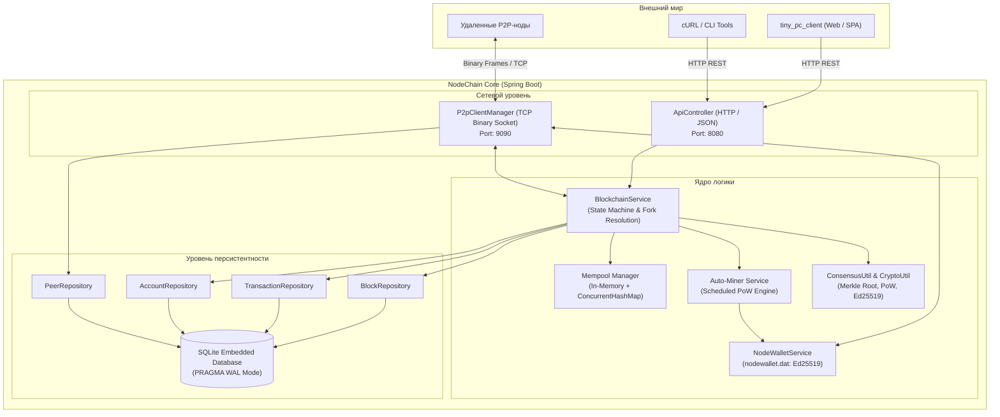
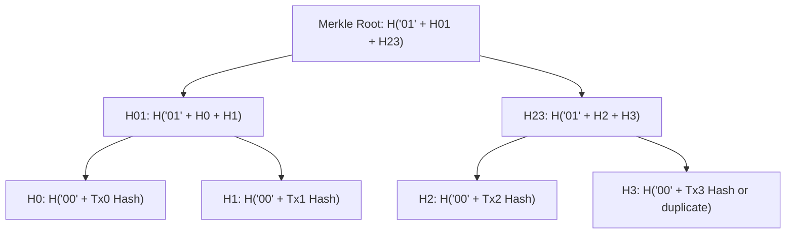
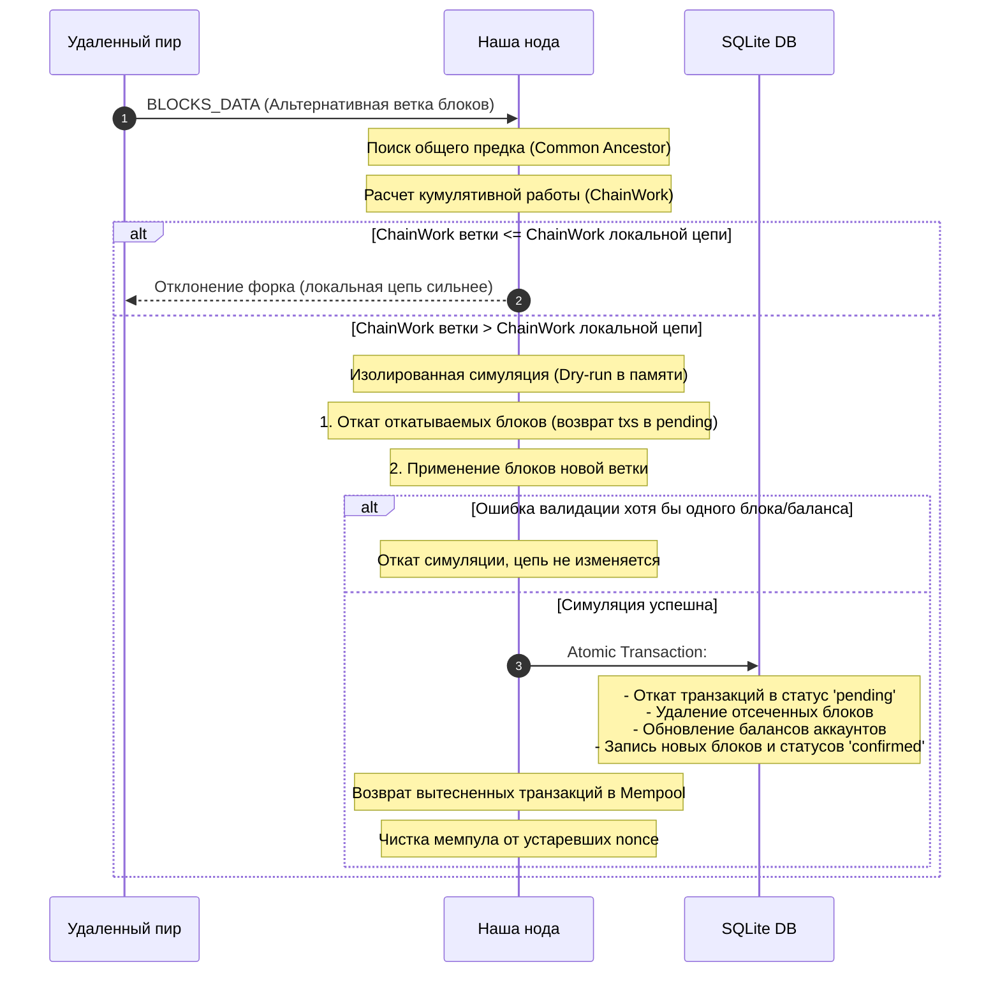

([go to Eng. ver](README.EN.md))

# 🦊 NodeChain

<p align="center">
  
  
  
  
  
  
  
</p>

> **Полнофункциональная распределенная блокчейн-нода на Java 17 и Spring Boot.**
> Написана без тяжелых внешних блокчейн-фреймворков: чистая криптография JDK (`Ed25519`, `SHA-256`, `RFC 6962 Merkle Tree`), легковесный SQLite в режиме WAL, собственный кастомный бинарный P2P-протокол со сжатием и защитой от переполнения, автономный SPA-клиент `tiny_pc_client` на Mithril.js и строгий REST API для интеграции клиентов и кошельков.

---

## 📑 Содержание

- [Зачем и для кого этот проект](#-зачем-и-для-кого-этот-проект)
- [Архитектура системы](#-архитектура-системы)
- [Криптография и Fox-адресация](#-криптография-и-fox-адресация)
- [Модель учетных записей (Account-Based)](#-модель-учетных-записей-account-based)
- [Консенсус: Proof-of-Work и Merkle Tree](#-консенсус-proof-of-work-и-merkle-tree)
- [Реорганизация цепи (Fork Choice & Reorg)](#-реорганизация-цепи-fork-choice--reorg)
- [Бинарный сетевой P2P-протокол](#-бинарный-сетевой-p2p-протокол)
- [Слой данных: SQLite + HikariCP](#-слой-данных-sqlite--hikaricp)
- [REST API v1 (Полная спецификация)](#-rest-api-v1-полная-спецификация)
- [Десктопный веб-клиент (tiny_pc_client)](#-десктопный-веб-клиент-tiny_pc_client)
- [Конфигурация и переменные окружения](#-конфигурация-и-переменные-окружения)
- [Быстрый старт](#-быстрый-старт)
  - [Сборка из исходников](#сборка-из-исходников)
  - [Запуск одиночной ноды](#запуск-одиночной-ноды)
  - [Запуск локальной сети (Multi-Node Testnet)](#запуск-локальной-сети-multi-node-testnet)
- [Генерация ключей и отправка транзакции (CLI & Python)](#-генерация-ключей-и-отправка-транзакции-cli--python)
- [Механизмы защиты и безопасность](#-механизмы-защиты-и-безопасность)
- [Тестирование](#-тестирование)
- [Структура проекта](#-структура-проекта)

---

## 💡 Зачем и для кого этот проект

Большинство обучающих или легковесных блокчейнов страдают одной из двух болезней:
1. Либо это игрушечный скрипт на 200 строк в памяти без сохранения, P2P-сети и валидации подписей.
2. Либо это монструозные комбайны (Hyperledger, Geth, Substrate), где за абстракциями невозможно понять математику транзакций, консенсус и протокол обмена пакетами.

**NodeChain** - это честная, понятная и инженерно строгая реализация децентрализованной ноды. Здесь нет «магии»:
* 🏎️ **Никаких тяжелых зависимостей**: криптография работает на нативной стандартной библиотеке Java (`java.security`).
* 📦 **Эффективное хранилище**: локальная БД SQLite в режиме высокопроизводительного журнала WAL (`Write-Ahead Logging`) с пулом соединений на базе HikariCP.
* 🌐 **Настоящий P2P**: кастомный бинарный framing поверх TCP с магическими байтами, опкодами, криптографическим рукопожатием (Mutual Signed Handshake) и авто-сжатием GZIP для больших пакетов блоков.
* 🛡️ **Защита от эксплойтов**: встроенная защита от Transaction Malleability, DoS-вытеснения мемпула, GZIP-бомб, Replay-атак по таймстампам и спама некорректными nonce.

---

## 🏛 Архитектура системы

Нода состоит из четко разделенных подсистем, спроектированных по принципу **Static-First & Clean Layers**:



---

## 🔐 Криптография и Fox-адресация

### 1. Алгоритм ключей и подписи
* **Алгоритм асимметричной криптографии**: `Ed25519` (RFC 8032) на нативном провайдере `java.security` в Java 17+.
* **Формат открытого ключа (Public Key)**: X.509 SPKI ASN.1, закодированный в `Base64` (размер сырого DER-ключа: ровно 44 байта, Base64: 60 символов вместо 392 у RSA).
* **Формат закрытого ключа (Private Key)**: PKCS#8 ASN.1, закодированный в `Base64` (размер сырого DER-ключа: ровно 48 байт, Base64: 64 символа).
* **Алгоритм цифровой подписи**: `Ed25519` (размер бинарной подписи: ровно 64 байта, Base64: 88 символов вместо 344 у RSA).
* **Производительность**: Скорость валидации и генерации подписей в 10–20 раз выше, а сетевой оверхед на передачу ключей и подписей сокращен более чем в 4 раза.

### 2. Формат Fox-адреса
Адрес кошелька в сети NodeChain представляет собой **64-значную строку** (`[0-9a-fox]{64}`), формируемую детерминированно из открытого ключа с подстановкой брендовых символов `'f'`, `'o'`, `'x'`:

1. Вычисляется `SHA-256` хеш от DER-байтов открытого ключа (`PublicKey.getEncoded()`).
2. Хеш переводится в 64-символьную hex-строку.
3. Первые 3 байта хеша определяют позиции подстановки символов бренда:
   * Байт 0 определяет позицию для `'f'` (в диапазоне индексов `0..4`).
   * Байт 1 определяет позицию для `'o'` (в диапазоне индексов `0..4`, исключая позицию `'f'`).
   * Байт 2 определяет позицию для `'x'` (в диапазоне индексов `0..4`, исключая позиции `'f'` и `'o'`).

> **Пример валидного адреса:**
> `f5ox17c91e0a29b2b2b1cf8813bc30e386abed50e82845bf13c8f8b8a531639d`

### 3. Канонический формат данных для подписи (Анти-Malleability & Cross-Chain Replay)
Транзакция подписывается строго по канонической строке (разделитель `|`) с обязательным указанием `chainId`:
- Если комментарий пустой или состоит из пробелов:  
  `chainId|from|to|amount|fee|nonce`
- Если комментарий есть:  
  `chainId|from|to|amount|fee|nonce|comment.trim()`

Хеш транзакции вычисляется от строки:
- Если комментарий пустой:  
  `chainId|from|to|amount|fee|nonce|signature`
- Если комментарий есть:  
  `chainId|from|to|amount|fee|nonce|comment.trim()|signature`

Все адреса перед расчетом хеша и верификацией приводятся к **нижнему регистру (`lowercase`)**, а комментарий триммится по краям, исключая расхождение подписи между нодой и клиентом.

---

## 👤 Модель учетных записей (Account-Based)

В отличие от UTXO (модели Биткоина), NodeChain использует **Account-based модель** (похожую на Ethereum):

| Параметр | Описание |
| :--- | :--- |
| **`address`** | Уникальный 64-символьный fox-адрес аккаунта. |
| **`balance`** | Подтвержденный баланс в атомарных единицах (целое число, `long`). 1 монета = $10^8$ сатоши/атомов. |
| **`nonce`** | Монотонно возрастающий счетчик транзакций, отправленных с данного адреса (начинается с `0`). |

### Правила обработки Nonce и Pipelining в Mempool
* **Защита от Replay-атак**: транзакция валидна только в том случае, если ее `nonce` в точности равен текущему ожидаемому `nonce` отправителя.
* **Mempool Pipelining**: отправитель может отправить несколько транзакций подряд в один блок:
  - `Tx_0` → nonce 0
  - `Tx_1` → nonce 1
  - `Tx_2` → nonce 2

  Нода автоматически выстроит цепочку в мемпуле и применит их последовательно.
* **Неподтвержденный баланс (Unconfirmed Balance)**: входящие неподтвержденные средства из мемпула **нельзя тратить** до их фактического включения в блок. Попытка потратить неподтвержденный баланс пресекается с ошибкой `409 Conflict`.

---

## ⛏ Консенсус: Proof-of-Work и Merkle Tree

### 1. Структура блока
```text
+--------------------------------------------------------------------------+
| Block Header                                                             |
|   height:        42                                                      |
|   previousHash:  00a8f93b...                                             |
|   merkleRoot:    7d2c418e...                                             |
|   minerAddress:  fox7a1bc...                                             |
|   timestamp:     1730912400000                                           |
|   difficulty:    4                                                       |
|   nonce:         184729                                                  |
|   hash:          0004bca1... (starts with "0" * difficulty)              |
+--------------------------------------------------------------------------+
| Transactions [ tx0, tx1, tx2, ... ]                                      |
+--------------------------------------------------------------------------+
```

### 2. Proof-of-Work (PoW) и автоподстройка сложности (Bitcoin-style DAA)
Майнер перебирает поле `nonce` блока до тех пор, пока хеш блока не будет удовлетворять условию сложности:
- **Block Payload** = `height|previousHash|merkleRoot|minerAddress|timestamp|difficulty|nonce`
- **Block Hash** = `SHA256(Block Payload)`
- **Valid PoW** - если `Block Hash` начинается с `difficulty` нулей (`00...0`)
- **Difficulty Adjustment Algorithm (DAA)**: каждые `blockchain.difficulty-adjustment-interval` блоков (по умолчанию 10) сложность пересчитывается на основе разницы времени между текущим блоком и якорным блоком интервала:
  - Если фактическое время интервала $< \text{targetTime} / 2$, сложность повышается на $+1$ (до `max-difficulty`).
  - Если фактическое время интервала $> \text{targetTime} \times 2$, сложность снижается на $-1$ (до `min-difficulty`).
  - Блоки с поддельной сложностью отклоняются сетью (`b.difficulty != expectedDiff`).
- **Genesis Block**: детерминированный `timestamp = 0L` и базовая сложность консенсуса.

### 3. Дерево Меркла (RFC 6962 Domain Separation)
Для защиты от атак второго прообраза (Second Preimage Attacks), при которых внутренний узел дерева выдается за лист транзакции, в хеширование внедрено строгое доменное разделение стандартом RFC 6962:
* **Листья транзакций (`Leaf`)**: хешируются с префиксом `00`:
  `H_leaf = SHA256("00" + tx.hash)`
* **Внутренние узлы (`Internal`)**: объединяются и хешируются с префиксом `01`:
  `H_parent = SHA256("01" + H_left + H_right)`
* Если количество элементов на уровне нечетное — последний элемент дублируется.
* Для блока без транзакций `merkleRoot = "0"`.



### 4. Алгоритм халвинга эмиссии (Bitcoin Core Subsidy Halving)
Эмиссия новых монет контролируется каноническим алгоритмом деления награды майнера пополам:

- `halvings = height / halvingInterval`
- При `halvings >= 64` награда равна strictly `0`
- В остальных случаях: `Subsidy = miningReward >> halvings`

Каждые `blockchain.halving-interval` блоков (по умолчанию 210 000) базовая награда уменьшается ровно в два раза побитовым сдвигом вправо, обеспечивая жесткий математический лимит совокупной эмиссии сети.

---

## 🔀 Реорганизация цепи (Fork Choice & Reorg)

Когда удаленный пир сообщает о ветке блоков, нода запускает процедуру разрешения форков по правилу **наибольшей кумулятивной работы (Highest Cumulative Chain Work)**:

**ChainWork** = сумма `16^difficulty` по всем блокам в ветке



### Алгоритм поиска предка и защита от зацикливания (Step-Back Protection)
Если полученный батч блоков не стыкуется с вершиной локальной цепи:
1. **Лимит глубины реорганизации (`MAX_REORG_DEPTH = 100`)**: Нода никогда не откатывает цепь глубже чем на 100 блоков от текущей вершины, защищая сеть от дальних атак переписывания истории (Long-Range Attacks).
2. **Шаг назад (`Step-Back`)**: Нода отступает назад по истории с шагом в 20 блоков (`Math.max(1, lowestReceived - 20)`) и отправляет запрос `GET_BLOCKS`.
3. **Защита от зацикливания отката**: Счетчик `peerStepBackCount` отслеживает шаги отката для каждого сетевого соединения. Если пир не может состыковать ветку и вызывает шаг назад более 10 раз подряд (`stepBacks > 10`), нода немедленно закрывает TCP-соединение, исключая DoS-зацикливание.
4. При нахождении локально известного общего предка (`Common Ancestor`) и подтверждении превосходства кумулятивной работы ветки (`branchWork > curWork`) нода выполняет симуляцию и транзакционный `reorganizeChain`.

---

## 📡 Бинарный сетевой P2P-протокол

Для минимизации оверхеда и максимальной скорости синхронизации ноды общаются по кастомному бинарному протоколу поверх прямого TCP-сокета.

### 1. Формат сетевого фрейма (Wire Frame Layout)

```text
 0                   1                   2                   3
 0 1 2 3 4 5 6 7 8 9 0 1 2 3 4 5 6 7 8 9 0 1 2 3 4 5 6 7 8 9 0 1
+-+-+-+-+-+-+-+-+-+-+-+-+-+-+-+-+-+-+-+-+-+-+-+-+-+-+-+-+-+-+-+-+
|          MAGIC (0x4658 "FX")          | FLAG  |               |
+-+-+-+-+-+-+-+-+-+-+-+-+-+-+-+-+-+-+-+-+-+-+-+-+-+-+-+-+-+-+-+-+
|                        REQUEST_ID                             |
+-+-+-+-+-+-+-+-+-+-+-+-+-+-+-+-+-+-+-+-+-+-+-+-+-+-+-+-+-+-+-+-+
|  OP_CODE  |                   PAYLOAD LENGTH                  |
+-+-+-+-+-+-+-+-+-+-+-+-+-+-+-+-+-+-+-+-+-+-+-+-+-+-+-+-+-+-+-+-+
|                                                               |
+                                                               +
|                      PAYLOAD BYTES                            |
+                     (JSON / GZIP)                             +
|                                                               |
+-+-+-+-+-+-+-+-+-+-+-+-+-+-+-+-+-+-+-+-+-+-+-+-+-+-+-+-+-+-+-+-+
```

| Поле | Тип | Размер | Описание |
| :--- | :--- | :--- | :--- |
| **`MAGIC`** | `short` | 2 байта | Константа `0x4658` (ASCII `"FX"`). Пакеты с другим magic немедленно реджектятся. |
| **`FLAG`** | `byte` | 1 байт | `0x00` = RAW JSON, `0x01` = GZIP Compressed JSON. |
| **`REQUEST_ID`** | `int32` | 4 байта | Идентификатор запроса (для сопоставления Request-Response). |
| **`OP_CODE`** | `byte` | 1 байт | Код команды (см. таблицу кодов ниже). |
| **`LENGTH`** | `int32` | 4 байта | Длина тела payload в байтах (максимум **8 MiB**). |
| **`PAYLOAD`** | `byte[]` | `LENGTH` | Содержимое сообщения в формате JSON (при FLAG=1 сжато GZIP). |

### 2. Таблица кодов операций (OpCodes)

| OpCode | Hex | Название | Назначение |
| :---: | :---: | :--- | :--- |
| **`1`** | `0x01` | `HANDSHAKE` | Первичное приветствие с криптографической подписью ноды. |
| **`2`** | `0x02` | `HANDSHAKE_ACK` | Ответное подтверждение хэндшейка со статусом локальной цепи. |
| **`3`** | `0x03` | `PING` | Проверка доступности пира (Keep-Alive каждые 20 секунд). |
| **`4`** | `0x04` | `PONG` | Ответ на пинг (обновляет поле `last_seen` в БД пиров). |
| **`16`** | `0x10` | `GET_PEERS` | Запрос списка известных активных узлов сети. |
| **`17`** | `0x11` | `PEERS_LIST` | Передача списка пиров (Gossip-обнаружение сети). |
| **`32`** | `0x20` | `GET_BLOCKS` | Запрос пакета блоков начиная с определенной высоты (батчами до 100). |
| **`33`** | `0x21` | `BLOCKS_DATA` | Передача массива блоков в ответ на `GET_BLOCKS`. |
| **`34`** | `0x22` | `NEW_BLOCK_ANNOUNCE` | Gossip-рассылка свежесмайненного блока по всей сети. |
| **`48`** | `0x30` | `NEW_TX_ANNOUNCE` | Gossip-рассылка новой неподтвержденной транзакции в мемпулы. |

### 3. Криптографический Handshake с защитой от Replay
Любое входящее TCP-соединение изолировано: пока удаленный узел не пришлет валидный `HANDSHAKE`, любые другие пакеты приводят к немедленному закрытию сокета.

**Структура Handshake сообщения:**
```json
{
  "nodeId": "f5ox17c91e0a29b2b2b1cf8813bc30e386abed50e82845bf13c8f8b8a531639d",
  "chainId": "foxchain-main-1",
  "height": 105,
  "latestBlockHash": "004aef72c81a...",
  "p2pPort": 9090,
  "version": "1.0.0",
  "timestamp": 1730912450123,
  "publicKey": "MCowBQYDK2VwAyEA4Q8w8i...",
  "signature": "81c03fa99b1a7d...",
  "sessionNonce": "b6a8e847-f495-46f9-b4b1-8406734d8ef0"
}
```

* Поле `nodeId` обязано в точности совпадать с fox-адресом, вычисленным из открытого ключа `publicKey` (Ed25519).
* Данные подписи: `nodeId|chainId|height|latestBlockHash|p2pPort|timestamp|sessionNonce`.
* **Строгий Nonce от Replay-атак**: поле `sessionNonce` является строго обязательным. Все использованные nonce регистрируются в `seenHandshakeNonces`. Повторная посылка старого или скопированного пакета рукопожатия мгновенно отклоняется. Для защиты от переполнения памяти при размере коллекции > 2000 записей неактивные nonce очищаются.
* Временное окно метки времени: от -60 секунд до +120 секунд от текущего системного времени узла.
* **Двустороннее обнаружение (Bidirectional Gossip)**: при приеме входящего соединения нода регистрирует реальный порт пира (`p2pPort`) в таблицу `peers` и сразу инициирует обмен активными адресами через `GET_PEERS` / `PEERS_LIST`.
* **Защита генезис-блока при синхронизации (`adoptPeerGenesisBlock`)**: чистая нода на высоте 0 принимает генезис удаленного узла только в том случае, если он строго валиден (соответствует `Block.createGenesis(remoteGenesis.minerAddress)`), а в локальной конфигурации не зафиксирован собственный `blockchain.genesis-address`.

---

## 🗄 Слой данных: SQLite + HikariCP

База данных работает на легковесном нативном драйвере `sqlite-jdbc` с тонкой настройкой под блокчейн-нагрузки:

* **`PRAGMA journal_mode = WAL;`** - режим Write-Ahead Logging позволяет параллельно читать данные без блокировки транзакций записи.
* **`PRAGMA synchronous = NORMAL;`** - идеальный баланс между надежностью сохранения на диск и скоростью коммита блоков.
* **`PRAGMA busy_timeout = 5000;`** - ожидание освобождения блокировок файла до 5 секунд во избежание `SQLITE_BUSY`.
* **`maximumPoolSize = 1`** - строго одно активное соединение в пуле HikariCP исключает взаимные блокировки многопоточной записи в один файл SQLite на уровне JVM.

### Схема таблиц

```sql
-- Таблица блоков цепочки
CREATE TABLE IF NOT EXISTS blocks (
  height INTEGER PRIMARY KEY,
  hash TEXT UNIQUE NOT NULL,
  previous_hash TEXT NOT NULL,
  merkle_root TEXT NOT NULL,
  miner_address TEXT NOT NULL,
  tx_count INTEGER NOT NULL,
  timestamp INTEGER NOT NULL,
  difficulty INTEGER NOT NULL DEFAULT 4,
  nonce INTEGER NOT NULL
);

-- Таблица транзакций
CREATE TABLE IF NOT EXISTS transactions (
  hash TEXT PRIMARY KEY,
  block_height INTEGER,
  block_hash TEXT,
  chain_id TEXT,
  tx_from TEXT NOT NULL,
  tx_to TEXT NOT NULL,
  amount INTEGER NOT NULL,
  fee INTEGER NOT NULL,
  nonce INTEGER NOT NULL,
  public_key TEXT NOT NULL,
  signature TEXT NOT NULL,
  comment TEXT,
  timestamp INTEGER NOT NULL,
  status TEXT NOT NULL,          -- 'pending' | 'confirmed' | 'failed'
  tx_index INTEGER DEFAULT 0     -- Позиция в блоке для сохранения Merkle Root
);

-- Индексы для быстрой пагинации и поиска истории
CREATE INDEX IF NOT EXISTS idx_tx_from ON transactions(tx_from);
CREATE INDEX IF NOT EXISTS idx_tx_to ON transactions(tx_to);
CREATE INDEX IF NOT EXISTS idx_tx_block_height ON transactions(block_height);
CREATE INDEX IF NOT EXISTS idx_tx_status ON transactions(status);

-- Таблица состояния балансов (State Ledger)
CREATE TABLE IF NOT EXISTS accounts (
  address TEXT PRIMARY KEY,
  balance INTEGER NOT NULL,
  nonce INTEGER NOT NULL,
  updated_at INTEGER NOT NULL
);

-- Таблица обнаруженных пиров
CREATE TABLE IF NOT EXISTS peers (
  host TEXT NOT NULL,
  port INTEGER NOT NULL,
  last_seen INTEGER NOT NULL,
  PRIMARY KEY (host, port)
);
```

---

## 🌐 REST API v1 (Полная спецификация)

API работает по умолчанию на порту `8080` с поддержкой CORS для веб-кошельков и дашбордов.

### 1. Состояние адреса
Возвращает подтвержденный баланс, неподтвержденный баланс (с учетом исходящих в мемпуле), текущий `nonce` и общее число транзакций.

* **URL**: `GET /api/v1/addresses/{address}`
* **Пример запроса**:
  ```bash
  curl http://localhost:8080/api/v1/addresses/f5ox17c91e0a29b2b2b1cf8813bc30e386abed50e82845bf13c8f8b8a531639d
  ```
* **Успешный ответ (200 OK)**:
  ```json
  {
    "address": "f5ox17c91e0a29b2b2b1cf8813bc30e386abed50e82845bf13c8f8b8a531639d",
    "balance": 100000000,
    "unconfirmedBalance": 99950000,
    "nonce": 1,
    "txCount": 1
  }
  ```
* **Ошибки**:
  * `400 Bad Request`: `{"code": 400, "message": "Некорректный формат адреса"}`
  * `404 Not Found`: `{"code": 404, "message": "Адрес еще не совершал транзакций и не имеет баланса"}`

---

### 2. Рекомендуемая комиссия сети
Оценивает комиссию в зависимости от желаемого приоритета включения в блок.

* **URL**: `GET /api/v1/transactions/fee?priority={low|normal|high}` *(по умолчанию: normal)*
* **Пример запроса**:
  ```bash
  curl http://localhost:8080/api/v1/transactions/fee?priority=high
  ```
* **Успешный ответ (200 OK)**:
  ```json
  {
    "fee": 100,
    "priority": "high"
  }
  ```
  *(Значения: `low` = 25, `normal` = 50, `high` = 100 атомарных единиц)*

---

### 3. Содержимое Mempool
Позволяет увидеть текущий пул неподтвержденных транзакций, ожидающих майнинга.

* **URL**: `GET /api/v1/transactions/mempool`
* **Пример запроса**:
  ```bash
  curl http://localhost:8080/api/v1/transactions/mempool
  ```
* **Успешный ответ (200 OK)**:
  ```json
  {
    "count": 1,
    "transactions": [
      {
        "hash": "a4d3f2...",
        "from": "f5ox...",
        "to": "8fox...",
        "amount": 50000,
        "fee": 50,
        "nonce": 0,
        "publicKey": "MIIBIj...",
        "signature": "sig...",
        "comment": "Оплата кофе",
        "timestamp": 1730912460000,
        "status": "pending"
      }
    ]
  }
  ```

---

### 4. История транзакций адреса (с пагинацией)
Возвращает список входящих и исходящих транзакций адреса, отсортированных по времени (свежие первыми).

* **URL**: `GET /api/v1/addresses/{address}/transactions?limit={limit}&offset={offset}`
* **Параметры**:
  * `limit` (int, default: 25, max: 100)
  * `offset` (int, default: 0, max: 10000)
* **Пример запроса**:
  ```bash
  curl "http://localhost:8080/api/v1/addresses/f5ox.../transactions?limit=10&offset=0"
  ```
* **Успешный ответ (200 OK)**:
  ```json
  {
    "total": 1,
    "txs": [
      {
        "hash": "e3b0c44298fc1c149afbf4c8996fb92427ae41e4649b934ca495991b7852b855",
        "from": "f5ox...",
        "to": "8fox...",
        "amount": 25000,
        "fee": 50,
        "comment": "Оплата заказа #42",
        "timestamp": 1730912000000,
        "status": "confirmed",
        "blockHeight": 12,
        "confirmations": 5
      }
    ]
  }
  ```

---

### 5. Отправка подписанной транзакции
Принимает подписанную транзакцию, валидирует подпись, баланс и nonce, помещает в локальный мемпул и бродкастит пирам через P2P.

* **URL**: `POST /api/v1/transactions/send`
* **Headers**: `Content-Type: application/json`
* **Параметры тела запроса**:
  * `chainId` (*string*, обязательное) — идентификатор блокчейн-сети (например, `"foxchain-main-1"`).
  * `from` (*string*, обязательное) — 64-символьный fox-адрес отправителя.
  * `to` (*string*, обязательное) — 64-символьный fox-адрес получателя (не равен `from`).
  * `amount` (*long*, обязательное) — сумма перевода в атомарных единицах ($> 0$).
  * `fee` (*long*, опционально, по умолчанию: `50`) — комиссия сети в атомарных единицах ($\ge 0$).
  * `nonce` (*long*, обязательное) — монотонный счетчик транзакций аккаунта ($\ge 0$).
  * `publicKey` (*string*, обязательное) — открытый Ed25519-ключ в кодировке Base64 (X.509 SPKI, 60 символов).
  * `signature` (*string*, обязательное) — цифровая подпись Base64 (`Ed25519`, 88 символов).
  * `comment` (*string*, опционально, по умолчанию: `""`, максимум 256 символов) — примечание.
* **Тело запроса**:
  ```json
  {
    "chainId": "foxchain-main-1",
    "from": "f5ox17c91e0a29b2b2b1cf8813bc30e386abed50e82845bf13c8f8b8a531639d",
    "to": "8fox32a11b0e29b2b2b1cf8813bc30e386abed50e82845bf13c8f8b8a531639a",
    "amount": 10000,
    "fee": 50,
    "nonce": 0,
    "publicKey": "MCowBQYDK2VwAyEA4Q8w8i02w9Gk2h6H2M7lFk4mP0...",
    "signature": "81c03fa99b1a7d6e5c4b3a2f1e0d9c8b7a6f5e4d3c2b1a0f...",
    "comment": "Перевод другу"
  }
  ```
* **Успешный ответ (200 OK)**:
  ```json
  {
    "hash": "c83b8a1e2d4...",
    "status": "pending",
    "addedAt": 1730912500123,
    "nonce": 0,
    "fee": 50
  }
  ```
* **Типовые коды ошибок**:
  * `400 Bad Request`: `{"code": 400, "message": "Подпись не верна"}` или `{"code": 400, "message": "Некорректный формат адреса"}`
  * `400 Bad Request`: `{"code": 400, "message": "Некорректный формат данных в теле запроса"}` (невалидный JSON, несовпадение типов или попытка передать float)
  * `409 Conflict`: `{"code": 409, "message": "Недостаточно средств"}`
  * `409 Conflict`: `{"code": 409, "message": "Конфликт nonce"}`
  * `409 Conflict`: `{"code": 409, "message": "Транзакция отклонена: неверный chainId"}`
  * `409 Conflict`: `{"code": 409, "message": "Транзакция отклонена: некорректный nonce"}`
  * `409 Conflict`: `{"code": 409, "message": "Транзакция отклонена: некорректное время"}`
  * `409 Conflict`: `{"code": 409, "message": "Транзакция отклонена: отправка самому себе"}`
  * `409 Conflict`: `{"code": 409, "message": "Транзакция отклонена: слишком длинный комментарий"}`
  * `409 Conflict`: `{"code": 409, "message": "Транзакция отклонена: некорректная сумма"}` / `"некорректная комиссия"`
  * `409 Conflict`: `{"code": 409, "message": "Транзакция отклонена: переполнение суммы и комиссии"}`
  * `409 Conflict`: `{"code": 409, "message": "Транзакция отклонена"}` (отсутствуют обязательные поля)
  * `415 Unsupported Media Type`: `{"code": 415, "message": "Неподдерживаемый тип медиа"}` (при Content-Type, отличном от `application/json`)
  * `429 Too Many Requests`: `{"code": 429, "message": "Mempool переполнен"}`

---

### 6. Просмотр транзакции по хешу
* **URL**: `GET /api/v1/transactions/{txHash}`
  * `{txHash}` строго ограничен 64-символьной шестнадцатеричной строкой (`[a-fA-F0-9]{64}`), что исключает конфликт маршрутизации с другими путями `/transactions/*`.
* **Пример запроса**:
  ```bash
  curl http://localhost:8080/api/v1/transactions/c83b8a1e2d4...
  ```
* **Успешный ответ (200 OK)**:
  ```json
  {
    "hash": "c83b8a1e2d4...",
    "from": "f5ox...",
    "to": "8fox...",
    "amount": 10000,
    "fee": 50,
    "comment": "Перевод другу",
    "timestamp": 1730912500123,
    "status": "confirmed",
    "blockHeight": 14,
    "blockHash": "00a94bf1...",
    "confirmations": 2
  }
  ```
* **Ошибки**: `404 Not Found`: `{"code": 404, "message": "Транзакция отсутствует"}`

---

### 7. Получение блока (по номеру, хешу или 'latest')
Универсальный эндпоинт для инспекции блоков.

* **URL**: `GET /api/v1/blocks/{identifier}`
  * `{identifier}` может быть числом высоты (`0`, `1`, `42`), словом `latest` или 64-значным хешем блока.
* **Пример запроса**:
  ```bash
  curl http://localhost:8080/api/v1/blocks/latest
  curl http://localhost:8080/api/v1/blocks/0
  ```
* **Успешный ответ (200 OK)**:
  ```json
  {
    "height": 0,
    "hash": "e6a1...",
    "previousHash": "0",
    "merkleRoot": "0",
    "minerAddress": "GENESIS",
    "nonce": 0,
    "txCount": 0,
    "timestamp": 0,
    "transactions": []
  }
  ```
* **Ошибки**: `404 Not Found`: `{"code": 404, "message": "Блок отсутствует"}`

---

### 8. Состояние сети и статус синхронизации
* **URL**: `GET /api/v1/network`
* **Пример запроса**:
  ```bash
  curl http://localhost:8080/api/v1/network
  ```
* **Успешный ответ (200 OK)**:
  ```json
  {
    "chainId": "foxchain-main-1",
    "height": 42,
    "latestBlockHash": "0002ab1f592...",
    "peers": 4,
    "isSynced": true,
    "version": "1.0.0"
  }
  ```

---

## 💻 Десктопный веб-клиент (tiny_pc_client)

В проект встроен автономный, ультралегкий SPA-клиент (`tiny_pc_client`), работающий прямо в браузере без необходимости установки Node.js, npm или сборщиков:

```text
tiny_pc_client/
├── index.html       # Единая HTML-точка входа (темная тема, адаптивная верстка)
├── css/
│   └── style.css    # Кастомные легковесные стили без тяжелых UI-фреймворков
└── js/
    ├── mithril.min.js # Реактивный микро-фреймворк (8 KiB gzipped)
    ├── crypto.js    # Криптографический модуль на базе нативного Web Crypto API (Ed25519)
    ├── api.js       # Клиент к REST API ноды NodeChain
    ├── state.js     # Централизованный стейт-менеджер с авто-пайплайнингом nonce
    └── app.js       # Компоненты интерфейса (Кошелек, Мемпул, Эксплорер, Dev Faucet)
```

### Возможности клиента:
* 🔑 **100% Non-Custodial & Web Crypto API**: Генерация и хранение приватных ключей `Ed25519` исключительно в браузере (`window.crypto.subtle`). Приватный ключ никогда не покидает клиентское устройство.
* 📥 **Импорт кошелька майнера `nodewallet.dat`**: Прямая вставка 3 строк из файла `nodewallet.dat` в форму импорта для удобного доступа к добытым блокам и премайну.
* 🚀 **Pipelining Nonce**: Клиент инспектирует мемпул ноды и вычисляет `nextNonce` с учетом неподтвержденных транзакций, позволяя отправлять серию переводов подряд без ожидания включения в блок.
* 🪙 **Dev Tool & Faucet**: Встроенная консоль разработчика для выдачи монет из кошелька майнера и отправки тестовых стресс-транзакций в сеть.
* 🔍 **Встроенный Block & Tx Explorer**: Мгновенный поиск блоков по высоте/хешу и транзакций с расчетом числа подтверждений (`confirmations`).
* 🌐 **Поддержка локального режима**: Клиент можно открыть двойным кликом прямо из файловой системы (`file:///.../index.html`) благодаря поддержке `originPatterns` в CORS ноды.

---

## ⚙ Конфигурация и переменные окружения

Нода поддерживает двухслойную конфигурацию:
1. Дефолтные значения из `application.properties`.
2. Пользовательские переопределения из локального файла `./server.properties` (создается автоматически при первом старте ноды в рабочей директории).
3. Системные переменные окружения или аргументы командной строки Spring Boot.

### Доступные параметры конфигурации

| Параметр | По умолчанию | Описание |
| :--- | :---: | :--- |
| **`server.port`** | `8080` | HTTP-порт для клиентского REST API. |
| **`node.p2p.port`** | `9090` | TCP-порт для входящих бинарных P2P-подключений. |
| **`node.db.path`** | `sqlite.db` | Путь к файлу базы данных SQLite. |
| **`blockchain.chain-id`** | `foxchain-main-1` | Уникальный ID сети (ноды с разными chain-id сбрасывают коннект). |
| **`blockchain.difficulty`** | `4` | Базовая сложность (количество ведущих нулей hex PoW-хеша блока). |
| **`blockchain.difficulty-adjustment-interval`** | `10` | Интервал ретаргетинга сложности (в блоках, как в Bitcoin). |
| **`blockchain.target-block-time-seconds`** | `10` | Целевое время нахождения одного блока (в секундах). |
| **`blockchain.min-difficulty`** | `1` | Минимальная допустимая сложность алгоритма DAA. |
| **`blockchain.max-difficulty`** | `16` | Максимальная допустимая сложность алгоритма DAA. |
| **`blockchain.mining-reward`** | `100000000` | Награда майнеру за добытый блок (в атомарных единицах). |
| **`blockchain.auto-mine`** | `true` | Включение автоматического фонового майнинга при наличии транзакций. |
| **`blockchain.mine-interval-seconds`**| `10` | Интервал проверки мемпула и попыток майнинга (в секундах). |
| **`blockchain.max-mempool-size`** | `10000` | Максимальное количество транзакций в очереди памяти. |
| **`blockchain.genesis-allocation`** | `1000000000000` | Начальная эмиссия Genesis Allocation (в атомарных единицах, 10 000 FOXT). |
| **`blockchain.genesis-address`** | *(пусто)* | Целевой адрес премайна (если не указан, начисляется на кошелек ноды `nodewallet.dat`). |
| **`blockchain.halving-interval`** | `210000` | Интервал халвинга эмиссии (каждые N блоков награда уменьшается вдвое). |
| **`node.p2p.seeds`** | *(пусто)* | Список стартовых пиров через запятую: `127.0.0.1:9091,192.168.1.50:9090`. |

> **Пример `server.properties` для второй локальной ноды:**
> ```properties
> server.port=8081
> node.p2p.port=9091
> node.db.path=node2.db
> node.p2p.seeds=127.0.0.1:9090
> ```

---

## 🚀 Быстрый старт

### Требования
* **JDK 17+** (Eclipse Temurin, OpenJDK или Oracle)
* **Apache Maven 3.8+**

### Сборка из исходников
Склонируйте репозиторий и соберите исполняемый Fat JAR:

```bash
# Клонирование
git clone https://github.com/foxso/nodechain.git
cd nodechain

# Сборка без тестов
mvn clean package -DskipTests

# Запуск полного набора интеграционных и криптографических тестов
mvn test
```
После успешной сборки готовый JAR будет лежать в `target/node.jar`.

---

### Запуск одиночной ноды

```bash
mkdir -p testnet && cd testnet
cp ../target/node.jar .

java -jar node.jar
```

При первом запуске нода выполнит следующие шаги:
1. Создаст дефолтный файл переопределений `server.properties` (если его нет).
2. Сгенерирует пару ключей Ed25519 и сохранит кошелек ноды в `nodewallet.dat`.
3. Инициализирует таблицы SQLite в файле `sqlite.db` и создаст детерминированный Genesis-блок #0.
4. Откроет бинарный P2P-сервер на порту `9090` и REST API на порту `8080`.
5. Запустит фоновый майнер, который будет автоматически собирать транзакции в блоки.

Проверьте работоспособность ноды в терминале:
```bash
curl http://localhost:8080/api/v1/network
```

---

### Запуск локальной сети (Multi-Node Testnet)

Развернем две ноды на одной машине, которые подключатся друг к другу, выполнят handshake и синхронизируют цепь:

```bash
# Терминал 1: Мастер-нода (Seed)
mkdir -p testnet/node1 && cd testnet/node1
cp ../../target/node.jar .
java -jar node.jar --server.port=8080 --node.p2p.port=9090 --node.db.path=node1.db
```

```bash
# Терминал 2: Вторая нода (Peer)
mkdir -p testnet/node2 && cd testnet/node2
cp ../../target/node.jar .
java -jar node.jar \
  --server.port=8081 \
  --node.p2p.port=9091 \
  --node.db.path=node2.db \
  --node.p2p.seeds=127.0.0.1:9090
```

Через секунду в логах обеих нод появится сообщение о взаимной авторизации по криптографическому хэндшейку:
```text
Registered incoming P2P peer connection: 127.0.0.1:9091
P2P peer verified & handshake confirmed for node f5ox...
```

---

## 🛠 Генерация ключей и отправка транзакции (CLI & Python)

Поскольку нода не хранит приватные ключи пользователей (non-custodial подход), подписание транзакций происходит на стороне клиента.

Ниже приведен готовый скрипт на **Python 3**, который генерирует ключи, вычисляет fox-адрес, подписывает транзакцию каноническим способом и отправляет её в ноду через REST API:

<details>
<summary>▶ Показать скрипт отправки транзакции (<code>wallet_client.py</code>)</summary>

```python
import base64
import hashlib
import json
import urllib.request
from cryptography.hazmat.primitives.asymmetric import ed25519
from cryptography.hazmat.primitives import serialization

# 1. Генерация ключей Ed25519
private_key = ed25519.Ed25519PrivateKey.generate()
public_key = private_key.public_key()

# 2. Экспорт ключей в форматы Base64
pub_der = public_key.public_bytes(
    encoding=serialization.Encoding.DER,
    format=serialization.PublicFormat.SubjectPublicKeyInfo
)
pub_b64 = base64.b64encode(pub_der).decode("utf-8")

# 3. Вычисление Fox-адреса
raw_sha = hashlib.sha256(pub_der).digest()
addr_chars = list(hashlib.sha256(pub_der).hexdigest())

pos_f = raw_sha[0] % 5
pos_o = raw_sha[1] % 5
while pos_o == pos_f:
    pos_o = (pos_o + 1) % 5
pos_x = raw_sha[2] % 5
while pos_x == pos_f or pos_x == pos_o:
    pos_x = (pos_x + 1) % 5

addr_chars[pos_f] = 'f'
addr_chars[pos_o] = 'o'
addr_chars[pos_x] = 'x'
sender_address = "".join(addr_chars).lower()

print(f"[*] Сгенерирован Fox-адрес: {sender_address}")

# 4. Формирование транзакции
chain_id = "foxchain-main-1"
recipient_address = "fox0000000000000000000000000000000000000000000000000000000000000" # валидный получатель
amount = 10000
fee = 50
nonce = 0
comment = "Привет из Python клиента!"

# Каноническая строка для подписи с chainId (защита от Cross-Chain Replay)
clean_comment = comment.strip() if comment else ""
canonical = (
    f"{chain_id}|{sender_address}|{recipient_address}|{amount}|{fee}|{nonce}|{clean_comment}"
    if clean_comment
    else f"{chain_id}|{sender_address}|{recipient_address}|{amount}|{fee}|{nonce}"
)

# 5. Подпись Ed25519 (RFC 8032)
signature_bytes = private_key.sign(canonical.encode("utf-8"))
sig_b64 = base64.b64encode(signature_bytes).decode("utf-8")

payload = {
    "chainId": chain_id,
    "from": sender_address,
    "to": recipient_address,
    "amount": amount,
    "fee": fee,
    "nonce": nonce,
    "publicKey": pub_b64,
    "signature": sig_b64,
    "comment": clean_comment
}

# 6. Отправка в ноду через REST
req = urllib.request.Request(
    "http://localhost:8080/api/v1/transactions/send",
    data=json.dumps(payload).encode("utf-8"),
    headers={"Content-Type": "application/json"}
)

try:
    with urllib.request.urlopen(req) as resp:
        print("[+] Ответ ноды:", resp.read().decode("utf-8"))
except urllib.error.HTTPError as e:
    print(f"[-] Ошибка отправки ({e.code}):", e.read().decode("utf-8"))
```
</details>

---

## 🛡 Механизмы защиты и безопасность

В коде реализованы строгие алгоритмические барьеры против распространенных атак на децентрализованные сети:

1. **Защита от Transaction Malleability (Пластичность транзакций)**:
   Подпись Ed25519 накладывается на строго детерминированную каноническую строку аргументов (`from|to|amount|fee|nonce|comment.trim()`). Никакие дополнительные поля или пробельные инъекции не могут нарушить целостность криптографической подписи.
2. **Защита от DoS-вытеснения мемпула (Tail Nonce Protection)**:
   При достижении лимита `maxMempoolSize` нода разрешает вытеснять транзакции с меньшей комиссией **только для хвостовых транзакций** (`tail nonce`). Запрещено вытеснять транзакцию с `nonce 0`, если от нее зависят `nonce 1` и `nonce 2`. Кроме того, отправитель без баланса не может вытеснить чужую валидную транзакцию.
3. **Защита от сетевых GZIP-бомб**:
   В методе `NodePacket.decompressGzip` стоит жесткий счетчик распакованных байт. Если поток превышает 8 MiB, распаковка немедленно прерывается с ошибкой ввода-вывода.
4. **Защита от переполнения целых чисел (Arithmetic Overflow)**:
   Все операции суммирования и вычитания сумм транзакций, комиссий и наград майнеров выполняются через `Math.addExact()` и `Math.subtractExact()`. Попытки передать отрицательную сумму или вызвать переполнение `Long.MAX_VALUE` пресекаются на уровне проверки базовых правил консенсуса.
5. **Защита от манипуляций со временем (Timestamp Drift)**:
   Блоки с меткой времени из далекого будущего ($>10$ минут вперед) или старше предыдущего блока немедленно отвергаются.
6. **Per-IP Rate Limiting с освобождением Localhost**:
   Входящие сетевые пакеты лимитируются по окну времени для каждой комбинации `IP:opcode` внешних хостов. Локальные адреса (`127.0.0.1`, `localhost`, `::1`) освобождены от лимитов для бесперебойного тестирования нод в кластере. Таблицы лимитов в P2P (`seenHandshakeNonces > 2000`) и REST API (`lastRestTxTime > 1000`) автоматически очищаются от старых записей, предотвращая утечки памяти (OOM DoS).
7. **Глобальная обработка исключений и иммунитет к 500 ошибкам (API Robustness)**:
   Все входящие HTTP-запросы проходят через `GlobalExceptionHandler`. Синтаксические ошибки JSON, переполнение типов, невалидные Content-Type или неподдерживаемые HTTP-методы перехватываются на уровне контроллера и возвращают строгие клиентские коды ошибок (`400 Bad Request`, `405 Method Not Allowed`, `415 Unsupported Media Type`, `409 Conflict`), исключая возникновение необработанных исключений `500 Internal Server Error`.
8. **Криптографическая самопроверка кошелька ноды (Challenge-Response Integrity)**:
   При инициализации `NodeWalletService` производит криптографическую валидацию ключевой пары Ed25519 через подписание проверочной строки `challenge-nodewallet.dat`. В случае повреждения файла нода останавливает запуск до открытия сетевых портов, исключая потерю наград за майнинг.
9. **Защита от передачи чисел с плавающей точкой (Anti-Float Coercion)**:
   Десериализация Jackson настроена на строгий запрет неявного усечения float к целым числам (`featuresToDisable(ACCEPT_FLOAT_AS_INT)` и свойство `spring.jackson.deserialization.accept-float-as-int=false`). Любая попытка передать дробное число в сумме или комиссии немедленно пресекается с кодом `400 Bad Request`.
10. **Лимит глубины реорганизации и защита от зацикливания отката (`MAX_REORG_DEPTH = 100`)**:
    Глубина отката цепи при реорганизации ограничена 100 блоками. Попытки пиров навязать более глубокий откат блокируются. При превышении 10 неудачных шагов отката подряд (`stepBacks > 10`) соединение с пиром принудительно разрывается.
11. **Защита от атак второго прообраза в Merkle Tree (RFC 6962 Domain Separation)**:
    Листья транзакций хешируются с префиксом `00`, а внутренние узлы — с префиксом `01`, исключая подмену промежуточного узла транзакцией.
12. **Защита генезис-блока и премайна (`adoptPeerGenesisBlock`)**:
    Чистая нода принимает генезис пира только при строгом соответствии канонической структуре `Block.createGenesis(minerAddress, difficulty)`, а при явно заданном `blockchain.genesis-address` в конфиге ноды любая подмена генезиса категорически блокируется.
13. **Bitcoin DAA и расчет ChainWork ($16^{\text{difficulty}}$)**:
    Автоматическая подстройка сложности майнинга каждые 10 блоков на основе реального времени генерации. Кумулятивная работа цепи рассчитывается как точная сумма $16^{\text{difficulty}}$ каждого блока. Блоки с заниженной или поддельной сложностью блокируются до сохранения.
14. **Изоляция Chain ID во всех операциях (Cross-Chain Replay Immunity)**:
    Идентификатор сети (`chainId`) жестко внедрен в канонические строки подписи, расчет хешей транзакций, вызовы REST API и P2P-хэндшейк, предотвращая воспроизведение транзакций в форках или параллельных сетях.
15. **Динамический расчет статуса `isSynced` по живым сокетам**:
    Высота каждого пира хранится в объекте `PeerConnection`, а статус синхронизации узла рассчитывается исключительно по живым соединениям. Злоумышленник больше не может вызвать вечный сброс синхронизации отправкой фейковой высоты.
16. **Защита Reorg от SQLite-нагрузки и лимиты Fast-Sync**:
    Валидация PoW альтернативной ветки выполняется строго до выборки откатываемых блоков из SQLite. Пакеты `BLOCKS_DATA` ограничены 100 блоками с автоматической пагинацией при начальной синхронизации.
17. **Защита от отравления истории (Anti-Poisoning)**:
    Отклонение транзакций с отрицательным `nonce < 0` и аномальными временными метками ($timestamp \le 0$ или $> \text{now} + 600\text{с}$) на раннем этапе до ресурсоемкой проверки подписи Ed25519.
18. **Защита таблицы пиров (Peer Table Protection)**:
    Ограничение таблицы `peers` до 256 записей, автоочистка неактивных узлов (> 7 дней) и ограничение пула одновременных попыток исходящих подключений не более 32.

---

## 🧪 Тестирование

Кодовая база покрыта строгими интеграционными тестами, проверяющими пограничные случаи, атаки, многопоточный майнинг и распределенный P2P-кластер (всего **81 тест**, проходящих со 100% успехом за ~11 секунд):

```bash
# Запуск всех тестов проекта
mvn test
```

### Основные тест-сьюты:
* `BlockchainIntegrationTest.java` (21 тест):
  * Тестирование всех 8+ эндпоинтов REST API через Spring `MockMvc`.
  * Проверка полного цикла: отправка транзакции $\rightarrow$ майнинг $\rightarrow$ обновление балансов и nonce.
  * Тест автоматической реорганизации цепи при обнаружении более длинного форка.
  * Проверка запрета траты неподтвержденных входящих средств.
  * Приоритезация транзакций майнером по размеру комиссии.
  * Mempool Pipelining: последовательная отправка цепочки транзакций с возрастающим nonce.
* `ClientApiFuzzAndRobustnessTest.java` (13 тестов, 50+ сценариев фаззинга):
  * Всесторонний стресс-тестинг и фаззинг REST API со стороны невалидного или враждебного клиента.
  * Проверка реакции на переполнение числовых типов, дробные числа, пустые тела запросов и отсутствующие поля.
  * Валидация граничных значений (лимиты пагинации, длина комментария $>256$ символов, регистронезависимость адресов).
  * Проверка инъекций (SQLi, `null`-байты) и неподдерживаемых HTTP-методов / Content-Type.
  * Полное подтверждение устойчивости API: 0 падений в статус `500 Internal Server Error`.
* `ClaudeReviewVerificationTest.java` (9 тестов):
  * Комплексная проверка аудита безопасности и архитектурных фиксов.
  * Принятие генезис-блока пира при старте чистой ноды и защита от подмены премайна.
  * Cross-Chain Replay анализ и доменная изоляция цепей.
  * Математика ChainWork без переполнения `BigInteger` со статической сложностью.
  * Лимитирование P2P-запросов по внешним IP и освобождение localhost.
  * Защита хэндшейка от Replay-атак через строгий `sessionNonce`.
  * DoS-защита: быстрые проверки формата транзакции до тяжелой проверки цифровой подписи.
  * Merkle Tree: строгое доменное разделение листьев (`00`) и узлов (`01`) по RFC 6962.
  * Ed25519: компактность ключей (44 байта DER / 60 Base64) и подписей (64 байта DER / 88 Base64).
  * Математика безопасного шага отката истории (`-20`).
* `MultiNodeNetworkTest.java` (10 тестов):
  * Тестирование реального P2P-кластера из двух и трех независимых нод на разных сетевых портах и базах данных SQLite.
  * Взаимная авторизация и криптографический Handshake с Ed25519-подписью.
  * Синхронизация транзакций в мемпулах через Gossip-протокол (`NEW_TX_ANNOUNCE`).
  * Мгновенный бродкаст смайненных блоков (`NEW_BLOCK_ANNOUNCE`).
  * Fast-Sync (Initial Block Download, IBD) для подключающихся узлов батчами `GET_BLOCKS`.
  * Автоматическая реорганизация форка (Chain Reorg) по правилу наибольшей кумулятивной работы (ChainWork).
  * Византийская устойчивость: изолирование и отклонение пиров, присылающих невалидные блоки.
  * Сквозная ретрансляция в mesh-сети (Multi-Hop Relay).
  * Обнаружение узлов через `GET_PEERS` / `PEERS_LIST` и устойчивость к разрывам соединений.
  * Изоляция разноименных сетей при несовпадении `chainId`.
* `ConsensusAndSecurityTest.java` (16 тестов):
  * Прерывание потока майнера и корректная остановка.
  * Защита от дубликатов транзакций внутри одного блока.
  * Проверка защиты от GZIP-бомб и валидации пакетов с неизвестными флагами.
  * Аутентификация P2P-хэндшейка, отклонение просроченных подписей и неавторизованных пакетов.
  * Тест защиты целостности кошелька ноды при повреждении файла `nodewallet.dat`.
  * Математический расчет халвинга награды за блок (Bitcoin Core Halving Algorithm).
  * Защита от вытеснения зависимых транзакций из мемпула (Tail Nonce Rule).
* `NewPlanSecurityAndDaaTest.java` (8 тестов):
  * Bitcoin DAA: повышение и понижение сложности в зависимости от темпа генерации блоков.
  * Точный расчет работы цепи как суммы $16^{\text{difficulty}}$ по блокам.
  * Отклонение блоков с заниженной, нулевой или поддельной сложностью.
  * Доменная изоляция `chainId` в канонической подписи и отсечение транзакций чужих сетей.
  * Каскадный сброс мемпула при обнаружении Nonce Gap.
  * Защита от OOM при приеме сетевых фреймов с превышением лимита длины.
  * Отклонение транзакций с отрицательным `nonce` или некорректным `timestamp`.
* `CryptoUtilTest.java` (2 теста):
  * Корректность генерации, длины (64 символа) и контрольных символов fox-адреса.
  * Валидация цифровых подписей Ed25519 (RFC 8032).
* `NodePacketTest.java` (2 теста):
  * Корректность упаковки и распаковки бинарных фреймов `NodePacket`.
  * Проверка автоматического GZIP-сжатия для пейлоадов $>128$ байт.

---

## 📂 Структура проекта

```text
nodechain/
├── pom.xml                   # Maven сборка (Java 17, Spring Boot 3.3.5)
├── README.md                 # Документация проекта (RU)
├── README.EN.md              # Документация проекта (EN)
├── tiny_pc_client/           # Автономный веб-клиент на Mithril.js (Ed25519 SPA)
│   ├── index.html            # Единая HTML-страница веб-кошелька
│   ├── css/
│   │   └── style.css         # Стили и темная тема интерфейса
│   └── js/
│       ├── mithril.min.js    # Легковесный реактивный фреймворк
│       ├── crypto.js         # Web Crypto API модуль (Ed25519)
│       ├── api.js            # HTTP-клиент к REST API ноды
│       ├── state.js          # Реактивное хранилище состояния
│       └── app.js            # Компоненты приложения (Кошелек, Explorer, Faucet)
├── src/main/java/so/fox/nodechain/
│   ├── NodechainApplication.java   # Точка входа Spring Boot
│   ├── api/
│   │   ├── ApiController.java      # Публичные эндпоинты REST API v1
│   │   └── GlobalExceptionHandler.java # Обработчик ошибок (400, 405, 415)
│   ├── config/
│   │   ├── DatabaseConfig.java     # SQLite WAL DataSource & HikariCP
│   │   └── NodeConfig.java         # Параметры ноды и валидация
│   ├── core/
│   │   ├── BlockchainService.java  # Мемпул, майнинг, форки и балансы
│   │   ├── ConsensusUtil.java      # Правила консенсуса, PoW и Merkle
│   │   ├── NodeWalletService.java  # Загрузка и проверка Ed25519-кошелька
│   │   └── Result.java             # Типизированный монолитный результат
│   ├── crypto/
│   │   └── CryptoUtil.java         # Ed25519, SHA-256, fox-адреса
│   ├── model/
│   │   ├── Account.java            # Модель аккаунта (баланс, nonce)
│   │   ├── Block.java              # Модель блока (PoW, Merkle tree)
│   │   ├── PeerInfo.java           # Модель сетевого пира
│   │   └── Transaction.java        # Модель транзакции и подпись
│   ├── p2p/
│   │   ├── P2pClientManager.java   # TCP-сервер, sync цепи, Gossip
│   │   ├── PeerConnection.java     # Активное TCP-соединение
│   │   └── packet/
│   │       ├── NodePacket.java     # Бинарный фрейм с GZIP-сжатием
│   │       └── OpCode.java         # Коды команд сетевого протокола
│   └── repository/
│       ├── AccountRepository.java  # Балансы и nonce в SQLite
│       ├── BlockRepository.java    # Блоки цепочки в SQLite
│       ├── PeerRepository.java     # Таблица обнаруженных пиров
│       └── TransactionRepository.java # Транзакции и история адресов
├── src/main/resources/
│   └── application.properties      # Конфигурация по умолчанию
└── src/test/java/so/fox/nodechain/
    ├── BlockchainIntegrationTest.java      # Тесты API, майнинга и reorg
    ├── ClaudeReviewVerificationTest.java   # Тесты аудита безопасности
    ├── ClientApiFuzzAndRobustnessTest.java # Фаззинг API и стресс-тесты
    ├── ConsensusAndSecurityTest.java       # Защита, P2P и правила PoW
    ├── CryptoUtilTest.java                 # Тесты подписей и fox-адресов
    ├── MultiNodeNetworkTest.java           # Тесты кластера из 2-3 нод
    ├── NewPlanSecurityAndDaaTest.java      # Тесты DAA, ChainWork и Nonce
    └── NodePacketTest.java                 # Тесты бинарного протокола
```

---

<p align="center">
  Разработано с ❤️ и вниманием к деталям. Никакого мусора, только чистая архитектура и надежный код.
</p>

